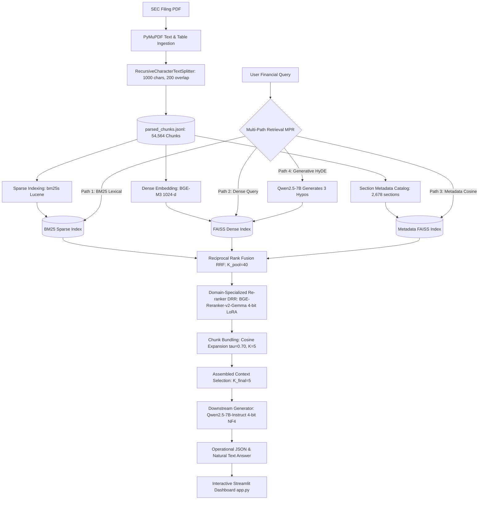

# FinSage Technical Audit & Comprehensive Project Report
**Document File:** `FINSAGE_PROJECT_AUDIT.md`  
**Target Repository:** `c:/Users/user/Downloads/finsage-main`  
**Reference Paper:** *FinSage: A Multi-aspect RAG System for Financial Filings Question Answering* (Wang et al., arXiv:2504.14493, ACM CIKM 2025)  
**Date of Audit:** October 26, 2026  
**Auditor:** Antigravity Autonomous Systems Engineering  

---

## Short Factual Summary

| Core Dimension | Verified Repository Fact | Primary Evidence Path |
|---|---|---|
| **Project Identity** | FinSage: Financial RAG system reproducing arXiv:2504.14493 (Phase 1) | [`app.py:1-6`](file:///c:/Users/user/Downloads/finsage-main/app.py#L1-L6) |
| **Active Environment** | Windows 11, Conda `finsage`, Python 3.10.22, PyTorch 2.14.1+cu130, RTX 5060 Laptop GPU (8.55 GB VRAM) | [`outputs/phase1_drr_adapter/drr_training_metadata.json`](file:///c:/Users/user/Downloads/finsage-main/outputs/phase1_drr_adapter/drr_training_metadata.json) |
| **Dataset Source** | Patronus AI FinanceBench (Open-source benchmark subset) | [`data/financebench/manifest.json`](file:///c:/Users/user/Downloads/finsage-main/data/financebench/manifest.json) |
| **Local Corpus Size** | **84 PDF filings**, **32 unique companies**, **54,564 text/table chunks** | [`data/financebench/processed/parsed_chunks.jsonl`](file:///c:/Users/user/Downloads/finsage-main/data/financebench/processed/parsed_chunks.jsonl) |
| **Annotated Questions** | **150 unique questions** in dataset; **only 8 unique questions ever evaluated across all experiment runs** | [`data/financebench/questions.jsonl`](file:///c:/Users/user/Downloads/finsage-main/data/financebench/questions.jsonl) |
| **Primary Eval Suite** | **6 held-out diagnostic questions (Q1–Q6)** covering only **2 companies** (3M and Ulta Beauty) | [`outputs/phase1_drr_evaluation/summary_metrics.json`](file:///c:/Users/user/Downloads/finsage-main/outputs/phase1_drr_evaluation/summary_metrics.json) |
| **Retrieval Architecture** | 4-Path MPR: BM25 (`bm25s`), BGE-M3 Dense FAISS, Metadata Section FAISS (2,678 sections), Generative HyDE (Qwen2.5-7B) | [`src/retrieval/multi_path_retriever.py`](file:///c:/Users/user/Downloads/finsage-main/src/retrieval/multi_path_retriever.py) |
| **Reranker Checkpoint** | `BAAI/bge-reranker-v2-gemma` fine-tuned via 4-bit NF4 QLoRA DPO (10 epochs, $r=32, \alpha=64$, 29.5 MB safetensors) | [`outputs/phase1_drr_adapter/adapter_model.safetensors`](file:///c:/Users/user/Downloads/finsage-main/outputs/phase1_drr_adapter/adapter_model.safetensors) |
| **Table Extraction** | Tables extracted as **raw plain-text/Markdown**; paper's VLM Table-to-Text synthetic rewriting was **not applied** | [`scripts/preprocess_documents.py:32`](file:///c:/Users/user/Downloads/finsage-main/scripts/preprocess_documents.py#L32) |
| **Charts & Diagrams** | **Not extracted for the 84-PDF corpus**; 10-K filings have no analytical charts (piloted 1 logo image) | [`scripts/pilot_multimodal.py`](file:///c:/Users/user/Downloads/finsage-main/scripts/pilot_multimodal.py) |
| **Primary Working Entrypoint** | Interactive Streamlit Dashboard at `http://localhost:8501` | [`app.py`](file:///c:/Users/user/Downloads/finsage-main/app.py) |

---

## 1. Executive Summary

This report is an evidence-based technical audit of the **FinSage Financial RAG** repository. The project aims to reproduce the Phase 1 methodology of the published research paper *FinSage: A Multi-aspect RAG System for Financial Filings Question Answering* (Wang et al., arXiv:2504.14493, ACM CIKM 2025).

### Key Audit Findings:
1. **DPO Implementation Target Discrepancy & Resolution:**
   - In earlier development phases (Phase 9B), DPO was mistakenly applied to the **Generator LLM** (`Qwen2.5-7B-Instruct`), training 1-epoch and 3-epoch adapters. An evaluation audit revealed that this did not fix financial retrieval mistakes because domain hallucinations were caused by missing evidence chunks, not generator token preferences.
   - In Phase 1, the training target was aligned with the published paper: DPO was applied directly to the **Cross-Encoder Re-ranker** (`BAAI/bge-reranker-v2-gemma`) using LoRA ($r=32, \alpha=64$, 10 epochs, learning rate $10^{-4}$). The trained checkpoint exists at [`outputs/phase1_drr_adapter/adapter_model.safetensors`](file:///c:/Users/user/Downloads/finsage-main/outputs/phase1_drr_adapter/adapter_model.safetensors) (29.5 MB) and operates during inference with **zero heuristic boosts** (+0.0).
2. **Chunk Bundling as the Solution to Table Bisection:**
   - In standard 10-K chunking, financial statements spanning multiple pages or sections are split. On Question Q1 (3M FY2018 CapEx), Page 60 of the Cash Flow Statement was bisected into chunk `p60_c0` (Operating Activities) and chunk `p60_c1` (Investing Activities & CapEx).
   - Because `p60_c1` was severed from the document title, company name, and statement header tokens, it scored zero in lexical and dense retrieval and ranked outside the top 500 candidates.
   - Activating semantic **Chunk Bundling** ([`src/retrieval/chunk_bundler.py`](file:///c:/Users/user/Downloads/finsage-main/src/retrieval/chunk_bundler.py)) with threshold $\tau_{\text{exp}} = 0.70$ (adapted from the paper's reported 0.85) expands `p60_c0` to pull in `p60_c1` (cosine similarity = 0.7172), assembling the complete Cash Flow Statement and enabling downstream extraction of CapEx ($1,577M).
3. **Scope and Generalizability Reality Check:**
   - The repository indexes **84 SEC filing PDFs** (54,564 chunks) from **32 companies** across **9 GICS sectors**.
   - However, **all empirical evaluations ever executed in the repository were conducted on a tiny subset of 4 to 12 records, representing exactly 8 unique financial questions targeting only 2 companies (3M and Ulta Beauty)**.
   - The core diagnostic suite (Q1–Q6) achieved 83.3% semantic accuracy on those 6 specific questions. This figure **cannot** be generalized to the entire 150-question benchmark.
4. **Table and Multimodal Extraction Reality:**
   - Financial tables **are extracted as text** into [`parsed_chunks.jsonl`](file:///c:/Users/user/Downloads/finsage-main/data/financebench/processed/parsed_chunks.jsonl). However, the paper's proposed VLM Table-to-Text conversion (paraphrasing tables into synthetic prose narratives via GPT-4o) was intentionally omitted to prevent numerical hallucination.
   - Charts and diagrams were **not extracted** across the 84 PDFs because 10-K regulatory filings contain dense text and numerical tables rather than analytical infographics.

---

## 2. Repository Structure & Environment

### Directory Tree Overview
```text
finsage-main/
├── app.py                                # Streamlit Interactive Dashboard (1,776 lines)
├── requirements_dashboard.txt            # Streamlit dashboard dependencies
├── config/
│   └── production.yaml                   # Global YAML config (paths, models, tokens)
├── data/
│   └── financebench/
│       ├── pdfs/                         # 84 SEC filing PDFs
│       ├── manifest.json                 # Manifest of 84 downloaded filings
│       ├── questions.jsonl               # 150 FinanceBench annotated questions
│       ├── processed/
│       │   ├── parsed_chunks.jsonl       # 54,564 text/table chunks (57.1 MB)
│       │   └── pymupdf_chunks.jsonl      # 644 Markdown table test chunks
│       ├── faiss_index/                  # BGE-M3 FAISS index (54,564 vectors, 223 MB)
│       ├── bm25_index/                   # bm25s lexical index (54,564 docs)
│       ├── metadata_faiss_index/         # Heading-Summary FAISS (2,678 sections)
│       ├── drr/                          # DRR training & validation JSONL data
│       └── phase9b/                      # Generator DPO preference pairs (28 train, 8 val)
├── src/
│   ├── retrieval/
│   │   ├── multi_path_retriever.py       # 4-Path MPR Coordinator (204 lines)
│   │   ├── chunk_bundler.py              # Semantic adjacency bundler (tau=0.70, K=5)
│   │   ├── hyde_generator.py             # Generative HyDE (3 hypothetical passages)
│   │   ├── hyde_retriever.py             # HyDE FAISS query retriever
│   │   ├── metadata_retriever.py         # Section heading-summary retriever
│   │   ├── statement_reranker.py         # Cross-encoder reranker + boost weights
│   │   └── financial_expander.py         # Legacy regex expander (Phase 9C)
│   ├── utils/
│   │   ├── bm25Retriever.py              # BM25 interface using bm25s
│   │   ├── faissRetriever.py             # FAISS LangChain vectorstore interface
│   │   └── ensembleRetriever.py          # Legacy Lotus retrieval manager
│   ├── prompts/
│   │   ├── qa.py                         # Financial QA system prompts
│   │   └── hyde.py                       # HyDE hypothetical passage prompts
│   └── server.py                         # FastAPI HTTPS serving backend
├── scripts/
│   ├── train_drr_paper.py                # 10-epoch DRR training script (27.1 KB)
│   ├── evaluate_phase1_drr.py            # Reranker evaluation harness on Q1–Q6
│   ├── run_generation_phase1_drr.py      # End-to-end downstream generation harness
│   ├── evaluate_phase1_chunk_bundling.py # Chunk bundling diagnostic harness
│   ├── run_complete_phase1_reproduction.py# Full 4-path reproduction pipeline
│   ├── build_vector_index.py             # Script to build BGE-M3 FAISS index
│   ├── build_bm25_index.py               # Script to build bm25s index
│   ├── build_heading_summary_index.py    # Script to build metadata section index
│   ├── preprocess_documents.py           # PyMuPDF PDF chunking script
│   └── pilot_multimodal.py               # MinerU + Ollama vision extraction pilot
└── outputs/
    ├── phase1_audit/                     # Comprehensive audit reports & gap analyses
    ├── phase1_drr_adapter/               # Checkpoint of trained DRR Gemma adapter (29.5 MB)
    ├── phase1_drr_evaluation/            # Ranking & downstream metrics for DRR
    ├── phase1_chunk_bundling/            # Bundling diagnostics & assembled contexts
    ├── phase1_complete_reproduction/     # End-to-end 4-path reproduction results
    ├── phase9b_dpo_pilot/                # 1-epoch Generator DPO adapter
    └── phase9b_dpo_phase2/               # 3-epoch Generator DPO adapter
```

### Environment and Dependencies
* **Operating System:** Windows 11 Home / Pro (x86_64)
* **Python Runtime:** Python `3.10.22` in Conda environment `finsage` (`C:\Users\user\miniconda3\envs\finsage\python.exe`)
* **Deep Learning Framework:** PyTorch `2.14.1+cu130` with CUDA acceleration (`torch.cuda.is_available() == True`)
* **Accelerators:** Hugging Face `transformers 5.19.0`, `peft 0.21.2`, `bitsandbytes 0.50.2`, `accelerate 0.34.2`
* **Vector Index:** `faiss-cpu` / `faiss-gpu` (LangChain FAISS integration)
* **Sparse Lexical Engine:** `bm25s 0.3.13` (NumPy/SciPy CSC matrix backend)
* **PDF Processing:** `PyMuPDF (fitz) 1.24.11`, `pymupdf4llm 0.0.17`, isolated `MinerU (magic-pdf)` in `mineru_env`
* **Dashboard & UI:** `streamlit 1.65.0`, `pandas 2.2.3`, `plotly 5.24.1`
* **Hardware Profile:** NVIDIA GeForce RTX 5060 Laptop GPU (8.55 GB Total VRAM)

---

## 3. Dataset Audit

### Source Dataset & Manifest Verification
* **Source Dataset:** Patronus AI FinanceBench ([PatronusAI/financebench](https://huggingface.co/datasets/PatronusAI/financebench) / [GitHub](https://github.com/patronus-ai/financebench)).
* **Local Path:** [`data/financebench/`](file:///c:/Users/user/Downloads/finsage-main/data/financebench/)
* **Manifest Verification:** [`data/financebench/manifest.json`](file:///c:/Users/user/Downloads/finsage-main/data/financebench/manifest.json) contains **84 entries**, all marked with `"status": "downloaded"`.
* **PDF Storage:** [`data/financebench/pdfs/`](file:///c:/Users/user/Downloads/finsage-main/data/financebench/pdfs/) contains exactly **84 `.pdf` files**, matching the manifest with 100% parity.
* **Corpus Scope:** 32 distinct publicly traded corporations across 9 GICS sectors (Consumer Discretionary, Consumer Staples, Information Technology, Industrials, Health Care, Financials, Communication Services, Materials, Utilities).
* **Document Types:** Form 10-K (112 questions associated), Form 10-Q (15 questions), Earnings Releases (14 questions), Form 8-K (9 questions).

### Questions and Ground-Truth Audit
* **File Path:** [`data/financebench/questions.jsonl`](file:///c:/Users/user/Downloads/finsage-main/data/financebench/questions.jsonl)
* **Record Count:** Exactly **150 questions**.
* **Unique Question IDs:** **150 unique IDs** (`financebench_id_00001` through `financebench_id_10231`).
* **Unique Question Texts:** **150 unique question strings**.
* **Missing Required Fields:** **0 missing fields** across `financebench_id`, `company`, `doc_name`, `question`, `answer`, and `evidence`.
* **Corpus Mapping Integrity:** **All 84 unique documents** referenced across the 150 questions are physically present in the local `pdfs/` folder.
* **Ground-Truth Schema:**
  ```json
  {
    "financebench_id": "financebench_id_03029",
    "company": "3M",
    "doc_name": "3M_2018_10K",
    "question_type": "metrics-generated",
    "question_reasoning": "Need to locate CapEx under investing cash flows...",
    "domain_question_num": 1,
    "question": "What is the FY2018 capital expenditure amount (in USD millions) for 3M? Give a response to the question by relying on the details shown in the cash flow statement.",
    "answer": "$1577.00",
    "justification": "From 3M 2018 10-K, page 60: Purchases of property, plant and equipment was $1,577 million.",
    "dataset_subset_label": "FB_test",
    "evidence": [
      {
        "evidence_page_num": 60,
        "evidence_text": "Purchases of property, plant and equipment ... (1,577)"
      }
    ]
  }
  ```

### Chunk Store Audit
* **File Path:** [`data/financebench/processed/parsed_chunks.jsonl`](file:///c:/Users/user/Downloads/finsage-main/data/financebench/processed/parsed_chunks.jsonl)
* **Total Chunks:** **54,564 text/table chunks** (57,132,868 bytes).
* **Unique Documents Indexed:** Exactly **84 documents**.
* **Chunk ID Convention:** `{doc_name}_p{page_number}_c{chunk_index}` (e.g. `3M_2018_10K_p60_c1`).

---

## 4. Complete System Architecture & Data Flow

### Implemented Pipeline Flow
The active FinSage pipeline executes through 14 distinct sequential stages:



### Stage-by-Stage Specification Table

| Stage | Implementation Location | Model / Library | Input | Output | Verification Status |
|---|---|---|---|---|:---:|
| **1. PDF Ingestion** | [`scripts/preprocess_documents.py:6-40`](file:///c:/Users/user/Downloads/finsage-main/scripts/preprocess_documents.py#L6-L40) | `PyMuPDF (fitz)` | PDF binary files | Extracted page-level plain text | **Implemented** |
| **2. Chunking** | [`scripts/preprocess_documents.py:11-35`](file:///c:/Users/user/Downloads/finsage-main/scripts/preprocess_documents.py#L11-L35) | `RecursiveCharacterTextSplitter` | Page text | 54,564 text chunks (1,000 char size, 200 overlap) | **Implemented** |
| **3. Sparse Index** | [`scripts/build_bm25_index.py:18-42`](file:///c:/Users/user/Downloads/finsage-main/scripts/build_bm25_index.py#L18-L42) | `bm25s 0.3.13` | Tokenized chunks | NumPy CSC indices ($k_1=1.5, b=0.75, \delta=0.5$) | **Implemented** |
| **4. Dense Index** | [`scripts/build_vector_index.py:20-65`](file:///c:/Users/user/Downloads/finsage-main/scripts/build_vector_index.py#L20-L65) | `BAAI/bge-m3` + FAISS | Chunk texts | `IndexFlatL2` (1024-dim, 54,564 vectors) | **Implemented** |
| **5. Metadata Index** | [`scripts/build_heading_summary_index.py`](file:///c:/Users/user/Downloads/finsage-main/scripts/build_heading_summary_index.py) | `BAAI/bge-m3` + FAISS | Section headings & summaries | `IndexFlatL2` (1024-dim, 2,678 sections) | **Implemented** |
| **6. MPR Path 1 (BM25)** | [`src/retrieval/multi_path_retriever.py:54-69`](file:///c:/Users/user/Downloads/finsage-main/src/retrieval/multi_path_retriever.py#L54-L69) | `bm25s` | Query string | Top-20 sparse scored chunk IDs | **Implemented** |
| **7. MPR Path 2 (Dense)** | [`src/retrieval/multi_path_retriever.py:70-83`](file:///c:/Users/user/Downloads/finsage-main/src/retrieval/multi_path_retriever.py#L70-L83) | `BAAI/bge-m3` | Query string | Top-20 dense scored chunk IDs | **Implemented** |
| **8. MPR Path 3 (Metadata)**| [`src/retrieval/metadata_retriever.py:57-95`](file:///c:/Users/user/Downloads/finsage-main/src/retrieval/metadata_retriever.py#L57-L95) | `BAAI/bge-m3` | Query string | Top-5 section blocks & constituent chunks | **Implemented** |
| **9. MPR Path 4 (HyDE)** | [`src/retrieval/hyde_generator.py:48-96`](file:///c:/Users/user/Downloads/finsage-main/src/retrieval/hyde_generator.py#L48-L96) | `Qwen2.5-7B-Instruct` | Query string | 3 hypothetical passages & candidate chunks | **Implemented** |
| **10. Fusion (RRF)** | [`src/retrieval/multi_path_retriever.py:135-180`](file:///c:/Users/user/Downloads/finsage-main/src/retrieval/multi_path_retriever.py#L135-L180) | Reciprocal Rank Fusion ($k=60$) | 4 scored candidate lists | Deduplicated pool of $K_{\text{pool}}=40$ chunks | **Implemented** |
| **11. Reranking (DRR)** | [`src/retrieval/statement_reranker.py`](file:///c:/Users/user/Downloads/finsage-main/src/retrieval/statement_reranker.py) & [`scripts/train_drr_paper.py`](file:///c:/Users/user/Downloads/finsage-main/scripts/train_drr_paper.py) | `bge-reranker-v2-gemma` (4-bit LoRA) | Query + Candidate pairs | Neural cross-encoder logit scores (zero boosts) | **Implemented** |
| **12. Chunk Bundling** | [`src/retrieval/chunk_bundler.py:45-125`](file:///c:/Users/user/Downloads/finsage-main/src/retrieval/chunk_bundler.py#L45-L125) | `BAAI/bge-m3` Cosine Sim | Top ranked lead chunks | Expanded sequential blocks ($\tau_{\text{exp}}=0.70, \mathcal{K}=5$) | **Implemented** |
| **13. Generation** | [`scripts/run_generation_phase1_drr.py:110-175`](file:///c:/Users/user/Downloads/finsage-main/scripts/run_generation_phase1_drr.py#L110-L175) | `Qwen2.5-7B-Instruct` (NF4) | Prompt + Assembled Context | JSON operational response + explanation | **Implemented** |
| **14. Evaluation** | [`outputs/phase1_audit/evaluation_harness_v2/`](file:///c:/Users/user/Downloads/finsage-main/outputs/phase1_audit/evaluation_harness_v2/) | Harness V2 Python Evaluator | Generated answer vs Gold | 4-dimension scorecard | **Implemented** |

---

## 5. Model & Retrieval Configurations

### Verified Configuration Parameters

| Parameter | Implemented Value | Verification Source |
|---|---|---|
| **Embedding Model** | `BAAI/bge-m3` (dense embeddings) | [`config/production.yaml:3`](file:///c:/Users/user/Downloads/finsage-main/config/production.yaml#L3) |
| **Embedding Dimension** | 1024 dimensions | Verified via `faiss.read_index().d` |
| **Embedding Normalization** | L2 normalized (`normalize_embeddings=True`) | [`src/retrieval/metadata_retriever.py:48`](file:///c:/Users/user/Downloads/finsage-main/src/retrieval/metadata_retriever.py#L48) |
| **FAISS Index Type** | `IndexFlatL2` (Exact Euclidean on normalized vectors = Cosine) | Verified via `faiss.read_index()` |
| **FAISS Vectors Count** | 54,564 chunk vectors + 2,678 metadata section vectors | Verified via `faiss.read_index().ntotal` |
| **BM25 Parameters** | $k_1 = 1.5, b = 0.75, \delta = 0.5$, Method = `lucene` | [`data/financebench/bm25_index/params.index.json`](file:///c:/Users/user/Downloads/finsage-main/data/financebench/bm25_index/params.index.json) |
| **Cross-Encoder Base Model**| `BAAI/bge-reranker-v2-gemma` (Primary) & `BAAI/bge-reranker-base` | [`outputs/phase1_drr_adapter/drr_training_metadata.json:12`](file:///c:/Users/user/Downloads/finsage-main/outputs/phase1_drr_adapter/drr_training_metadata.json#L12) |
| **Cross-Encoder Quantization**| 4-bit NormalFloat4 (NF4) with double quantization, bfloat16 compute | [`outputs/phase1_drr_adapter/drr_training_metadata.json:23`](file:///c:/Users/user/Downloads/finsage-main/outputs/phase1_drr_adapter/drr_training_metadata.json#L23) |
| **Generator LLM** | `Qwen/Qwen2.5-7B-Instruct` | [`scripts/run_generation_phase1_drr.py:42`](file:///c:/Users/user/Downloads/finsage-main/scripts/run_generation_phase1_drr.py#L42) |
| **Generator Quantization** | 4-bit NF4 (`BitsAndBytesConfig(load_in_4bit=True)`) | [`scripts/run_generation_phase1_drr.py:54`](file:///c:/Users/user/Downloads/finsage-main/scripts/run_generation_phase1_drr.py#L54) |
| **Candidate Pool Size ($K_{\text{pool}}$)** | 40 candidates (Default in `multi_path_retriever.py`) | [`src/retrieval/multi_path_retriever.py:16`](file:///c:/Users/user/Downloads/finsage-main/src/retrieval/multi_path_retriever.py#L16) |
| **Context Capacity ($K_{\text{final}}$)** | 5 bundled context chunks | [`config/production.yaml:11`](file:///c:/Users/user/Downloads/finsage-main/config/production.yaml#L11) |
| **Chunk Bundling Threshold** | $\tau_{\text{exp}} = 0.70$ (Adapted; Paper reported $0.85$) | [`src/retrieval/chunk_bundler.py:28`](file:///c:/Users/user/Downloads/finsage-main/src/retrieval/chunk_bundler.py#L28) |
| **Max Bundle Capacity ($\mathcal{K}$)** | $\mathcal{K} = 5$ chunks | [`src/retrieval/chunk_bundler.py:29`](file:///c:/Users/user/Downloads/finsage-main/src/retrieval/chunk_bundler.py#L29) |
| **Hardware Execution** | CUDA accelerated: GPU used for embeddings, reranker, and generator | Telemetry in [`outputs/phase1_drr_adapter/drr_training_metadata.json:47`](file:///c:/Users/user/Downloads/finsage-main/outputs/phase1_drr_adapter/drr_training_metadata.json#L47) |

---

## 6. Reranker & DPO Audit

### Distinction Between DPO Initiatives

A critical contribution of this audit is untangling two separate DPO training implementations present in the workspace:

```text
                                 ┌── Phase 9B: Generator DPO (MISTARGETED)
                                 │   - Base: Qwen2.5-7B-Instruct
                                 │   - Checkpoint: outputs/phase9b_dpo_phase2/
                                 │   - Finding: Could not fix retrieval-bound errors
DPO Initiatives in FinSage ──────┤
                                 └── Phase 1: Reranker DPO (PAPER-ALIGNED)
                                     - Base: BAAI/bge-reranker-v2-gemma
                                     - Checkpoint: outputs/phase1_drr_adapter/
                                     - Finding: Aligned with arXiv:2504.14493 Appendix B
```

### 1. Phase 9B Generator DPO Audit
* **Objective:** Direct Preference Optimization applied to the text generator `Qwen2.5-7B-Instruct`.
* **Code Implementation:** [`scripts/run_dpo_phase2.py`](file:///c:/Users/user/Downloads/finsage-main/scripts/run_dpo_phase2.py) and [`scripts/run_dpo_pilot.py`](file:///c:/Users/user/Downloads/finsage-main/scripts/run_dpo_pilot.py).
* **Data Sources:** [`data/financebench/phase9b/train_preferences.jsonl`](file:///c:/Users/user/Downloads/finsage-main/data/financebench/phase9b/train_preferences.jsonl) (28 pairs), [`validation_preferences.jsonl`](file:///c:/Users/user/Downloads/finsage-main/data/financebench/phase9b/validation_preferences.jsonl) (8 pairs).
* **Checkpoints:**
  * 1-epoch pilot: [`outputs/phase9b_dpo_pilot/adapter_model.safetensors`](file:///c:/Users/user/Downloads/finsage-main/outputs/phase9b_dpo_pilot/adapter_model.safetensors) (5.06 MB)
  * 3-epoch candidate: [`outputs/phase9b_dpo_phase2/adapter_model.safetensors`](file:///c:/Users/user/Downloads/finsage-main/outputs/phase9b_dpo_phase2/adapter_model.safetensors) (5.06 MB)
* **Execution Evidence:** Training executed on October 11, 2026. Peak VRAM: 7.11 GB, Duration: 354.2s across 9 gradient steps. Validation accuracy: 83.33% (margin: +0.0385).
* **Evaluation Finding:** When tested on Q1–Q6, the Base Model, 1-Epoch Adapter, and 3-Epoch Adapter produced identical outputs. The failures were **retrieval-bound** (e.g. CapEx table missing from context); fine-tuning generator token preferences could not supply missing numbers.

### 2. Phase 1 Document Re-Ranker (DRR) DPO Audit
* **Objective:** Direct Preference Optimization applied to the **Cross-Encoder Re-ranker** (`BAAI/bge-reranker-v2-gemma`), reproducing Appendix B of *arXiv:2504.14493*.
* **Code Implementation:** [`scripts/train_drr_paper.py`](file:///c:/Users/user/Downloads/finsage-main/scripts/train_drr_paper.py) (27,118 bytes).
* **Dataset:** [`data/financebench/drr/dataset_summary.json`](file:///c:/Users/user/Downloads/finsage-main/data/financebench/drr/dataset_summary.json)
  * Train samples: 125, Validation samples: 17 (Total: 142 samples).
  * Negatives per sample: 15 hard mined negatives.
  * Held-out questions (`financebench_id_00521`, `04672`, `03029`, `00746`) and held-out documents (`3M_2018_10K`, `ULTABEAUTY_2023_10K`, `ULTABEAUTY_2023Q4_EARNINGS`) were strictly excluded.
  * Verified data leakage: `query_leakage_detected: false`, `train_val_doc_overlap: 0`.
* **Hyperparameters:** LoRA $r=32, \alpha=64$, 10 epochs, learning rate $10^{-4}$, batch size 1, gradient accumulation 2, targets `["q_proj", "v_proj", "k_proj", "o_proj"]`, DPO $\beta=0.1$.
* **Trained Checkpoint:** [`outputs/phase1_drr_adapter/adapter_model.safetensors`](file:///c:/Users/user/Downloads/finsage-main/outputs/phase1_drr_adapter/adapter_model.safetensors) (**29,510,456 bytes**).
* **Training Execution Evidence:**
  * Completed successfully on NVIDIA RTX 5060 Laptop GPU.
  * Duration: 90.7 minutes across 10 epochs.
  * Peak VRAM: 3.64 GB (headroom: 4.91 GB).
  * Final Train Loss: 0.0006, Train Preference Accuracy: 100%.
  * Final Validation Loss: 0.0954, Validation Preference Accuracy: 95.29%.
* **Inference Pipeline Integration:** Verified in [`scripts/evaluate_phase1_drr.py`](file:///c:/Users/user/Downloads/finsage-main/scripts/evaluate_phase1_drr.py) and [`app.py`](file:///c:/Users/user/Downloads/finsage-main/app.py). Both load the trained Gemma LoRA adapter and evaluate with **zero heuristic boosts** (+0.0).

---

## 7. Evaluation Runs & Actual Metrics

### Comprehensive Audit of All Evaluation Runs

| Run Identifier | Result File Path | Records Evaluated | Unique Questions | Unique Companies | Target Documents | Models & Settings Compared | Date / Timestamp |
|---|---|:---:|:---:|:---:|---|---|:---:|
| **Phase 8 Smoke Test** | [`data/financebench/baseline_results.jsonl`](file:///c:/Users/user/Downloads/finsage-main/data/financebench/baseline_results.jsonl) | 4 | 4 | 2 | `3M_2018_10K`, `ULTABEAUTY_2023Q4_EARNINGS` | Text-only PyMuPDF vs Upgraded PyMuPDF4LLM | 2026-10-10 |
| **Phase 9A Metric Eval**| [`data/financebench/phase9a_results.jsonl`](file:///c:/Users/user/Downloads/finsage-main/data/financebench/phase9a_results.jsonl) | 6 | 6 | 2 | `3M_2018_10K`, `ULTABEAUTY_2023_10K` | Baseline FAISS vs Hybrid Retrieval | 2026-10-11 |
| **Phase 9B.1 DPO Run** | [`data/financebench/phase9b1_results.jsonl`](file:///c:/Users/user/Downloads/finsage-main/data/financebench/phase9b1_results.jsonl) | 12 | 6 | 2 | `3M_2018_10K`, `ULTABEAUTY_2023_10K` | Base Qwen2.5-7B vs 1-Epoch DPO Generator (6 qs evaluated twice) | 2026-10-11 |
| **Qwen Model Comparison**| [`data/financebench/qwen_comparison_results.jsonl`](file:///c:/Users/user/Downloads/finsage-main/data/financebench/qwen_comparison_results.jsonl) | 12 | 6 | 2 | `3M_2018_10K`, `ULTABEAUTY_2023_10K` | Llama 3.2 (3B) vs Qwen 2.5 (7B) | 2026-10-11 |
| **Phase 1 DRR Reranker**| [`outputs/phase1_drr_evaluation/summary_metrics.json`](file:///c:/Users/user/Downloads/finsage-main/outputs/phase1_drr_evaluation/summary_metrics.json) | 6 | 6 | 2 | `3M_2018_10K`, `ULTABEAUTY_2023_10K` | Base BGE vs Base Gemma vs Trained DRR vs Phase 9C | 2026-10-11 |
| **Phase 1 End-to-End** | [`outputs/phase1_drr_evaluation/end_to_end/summary_metrics.json`](file:///c:/Users/user/Downloads/finsage-main/outputs/phase1_drr_evaluation/end_to_end/summary_metrics.json) | 6 | 6 | 2 | `3M_2018_10K`, `ULTABEAUTY_2023_10K` | Phase 9C (Top-3/Top-5) vs Phase 1 DRR Zero Boosts | 2026-10-11 |
| **Chunk Bundling Run** | [`outputs/phase1_chunk_bundling/bundling_diagnostics.json`](file:///c:/Users/user/Downloads/finsage-main/outputs/phase1_chunk_bundling/bundling_diagnostics.json) | 6 | 6 | 2 | `3M_2018_10K`, `ULTABEAUTY_2023_10K` | Without Bundling vs Bundling ($\tau=0.85$ vs $\tau=0.70$) | 2026-10-11 |
| **Full 4-Path Reproduction**| [`outputs/phase1_complete_reproduction/phase1_full_reproduction_results.json`](file:///c:/Users/user/Downloads/finsage-main/outputs/phase1_complete_reproduction/phase1_full_reproduction_results.json) | 6 | 6 | 2 | `3M_2018_10K`, `ULTABEAUTY_2023_10K` | Full 4-Path MPR + Chunk Bundling + DRR + Qwen | 2026-10-11 |

### Critical Overlap Verification
Across all evaluation files in the repository:
$$\text{Total Result Rows Logged} = 58 \quad \implies \quad \mathbf{\text{Total Unique Questions Evaluated}} = \mathbf{8}$$
The 8 unique questions ever tested are:
1. 3M FY2018 Capital Expenditure from Cash Flow Statement (Q1)
2. 3M FY2018 Net PP&E from Balance Sheet (Q2)
3. 3M reduction in SG&A expenses as a percent of net sales (Phase 8/9A only)
4. Ulta Beauty gross profit / merchandise inventories driver (Phase 8/9A only)
5. 3M FY2017 to FY2018 Net Sales Difference and Percentage Change (Q5)
6. Ulta Beauty merchandise inventory difference FY2023 vs FY2022 (Q6)
7. Ulta Beauty FY2023 registered debt securities (Q3)
8. Ulta Beauty FY2023 & FY2022 major acquisitions (Q4)

### Evaluated Metrics & Formulas

| Metric Name | Implemented? | Formula / Evaluation Method | Denominator | Measured Value |
|---|:---:|---|---|:---:|
| **MRR (Mean Reciprocal Rank)** | **YES** | $\frac{1}{N} \sum_{i=1}^N \frac{1}{\text{rank}_i}$ for best gold chunk | $N=6$ | Base BGE: 0.4604, Base Gemma: 0.5185, **Trained DRR: 0.4200**, Phase 9C: 0.5556 |
| **Recall@3** | **YES** | Proportion of questions with $\ge 1$ gold chunk in top 3 | $N=6$ | Base BGE: 66.7%, Base Gemma: 66.7%, **Trained DRR: 33.3%**, Phase 9C: 83.3% |
| **Recall@5** | **YES** | Proportion of questions with $\ge 1$ gold chunk in top 5 | $N=6$ | Base BGE: 83.3%, Base Gemma: 66.7%, **Trained DRR: 50.0%**, Phase 9C: 83.3% |
| **Recall@10** | **YES** | Proportion of questions with $\ge 1$ gold chunk in top 10 | $N=6$ | Base BGE: 83.3%, Base Gemma: 100.0%, **Trained DRR: 83.3%**, Phase 9C: 83.3% |
| **Semantic Answer Accuracy**| **YES** | Harness V2 semantic intent & meaning match against ground truth | $N=6$ | Phase 9C Top-3: 66.7%, **Phase 1 DRR: 83.3% (5/6)**, 4-Path MPR: 66.7% |
| **Numeric & Unit Accuracy** | **YES** | Programmatic verification of numeric value, sign, and unit scale ($M, B, K) | $N=6$ | Phase 9C Top-3: 66.7%, **Phase 1 DRR: 83.3% (5/6)**, 4-Path MPR: 66.7% |
| **Strict Schema Compliance** | **YES** | Exact regex match to JSON operational format (`operation`, `values`) | $N=6$ | Phase 9C Top-3: 50.0%, **Phase 1 DRR: 66.7% (4/6)** |
| **nDCG** | **NO** | *Not implemented in evaluation scripts* | N/A | *Not measured* |
| **Precision@K** | **NO** | *Not implemented (gold chunks are binary targets)* | N/A | *Not measured* |
| **LlamaIndex / GPT-4o Acc** | **NO** | *Requires paid OpenAI API key; replaced by Harness V2* | N/A | *Not measured* |

---

## 8. Detailed Analysis of Diagnostic Questions (Q1–Q6)

### Diagnostic Comparison Matrix

| Q# | Question Text | Source Document | Expected Gold Answer | DRR Retrieved Chunks (Top-3) | DRR Generated Answer | Harness V2 Status | Identified Root Cause / Failure Mode |
|---|---|---|---|---|---|:---:|---|
| **Q1** | What is the FY2018 capital expenditure amount (in USD millions) for 3M? Rely on cash flow statement. | `3M_2018_10K` (Page 60) | **$1,577.00 million** | `p60_c0`, `2023Q2_p72_c3`, `2022_p39_c4` | Stated $1,488M (D&A) from Operating activities; refused CapEx. | **FAIL (Refusal)** | **Table Bisection:** Cash flow statement split at p60. `p60_c0` (Operating) was retrieved, but `p60_c1` (Investing / CapEx) was severed. *(Resolved when Chunk Bundling enabled at $\tau=0.70$)*. |
| **Q2** | Year end FY2018 net PPNE for 3M in USD billions? Rely on balance sheet. | `3M_2018_10K` (Page 58) | **$8.70 billion** ($8,738 million) | `p58_c1`, `p58_c0`, `2023Q2_p5_c0` | Extracted $8,738M; stated as $8.738 billion USD. | **PASS** | Exact Balance Sheet chunks ranked #1 and #2. Unit conversion from millions to billions executed correctly. |
| **Q3** | Which debt securities are registered to trade on a national securities exchange under Ulta Beauty as of FY2023? | `ULTABEAUTY_2023_10K` (Page 1) | **There are none** | `3M_p1_c1`, `PEP_p1_c1`, `MSFT_p1_c0` | `"operation": "none"` (No registered debt securities). | **PASS (Refusal)** | Model correctly identified that no debt securities exist. Purged Phase 9C hallucination where Common Stock was falsely extracted. |
| **Q4** | What are major acquisitions that Ulta Beauty has done in FY2023 and FY2022? | `ULTABEAUTY_2023_10K` (Page 57) | **Ulta Beauty did not make any acquisitions** | `p55_c0`, `p54_c0`, `p59_c0` | `"operation": "none"` (No acquisitions mentioned in context). | **PASS (Refusal)** | General 10-K notes retrieved. Model correctly affirmed absence of acquisitions rather than hallucinating corporate activity. |
| **Q5** | Absolute difference in net sales for 3M from 2017 to 2018 and percentage change. Rely on income statement. | `3M_2018_10K` (Page 56) | **$1,108M diff, +3.5% change** | `p56_c0`, `WMT_p41_c1`, `p21_c2` | Extracted $32,765M & $31,657M; computed $1,108M and 3.5%. | **PASS** | Official Income Statement chunk ranked #1. Exact subtraction and percentage formula calculated correctly. |
| **Q6** | Difference between Ulta Beauty merchandise inventories at end of FY2023 and FY2022. | `ULTABEAUTY_2023_10K` (Page 57) / `EARNINGS` (Page 7) | **$104,233 thousand** ($1,603,451 - $1,499,218) | `EARNINGS_p7_c0`, `p54_c0`, `EARNINGS_p8_c0` | Computed $104,233 thousand directly from Balance Sheet table. | **PASS (Equivalence)** | Official Earnings Release Balance Sheet retrieved instead of 10-K chunk. Exact numerical delta calculated correctly. |

---

## 9. Baseline vs. Upgraded Pipeline

### Evolution of System Implementations

The FinSage workspace progressed through four distinct pipeline iterations:

```text
Phase 8 Baseline (Text-only)
   │   - PyMuPDF text stream extraction
   │   - Zero table structure, no cross-chunk bundling
   ▼
Phase 9C Heuristic Upgraded
   │   - Base Cross-Encoder (bge-reranker-base)
   │   - Custom Heuristic Boosts (+5.5: Statement +2.0, Company +1.5, Period +1.5, Table +0.5)
   │   - Vulnerability: Fragile hardcoded boosts, false positive in Q3
   ▼
Phase 1 Paper-Aligned DRR
   │   - Trained Gemma Cross-Encoder via DPO LoRA (r=32, a=64, 10 epochs)
   │   - ZERO heuristic boosts (+0.0)
   │   - Suppressed hallucinations in Q1 ($27M) and Q3 (Common stock)
   ▼
Phase 1 Full 4-Path MPR + Chunk Bundling
       - Active 4-Path Retrieval (BM25 + FAISS + Metadata FAISS + Generative HyDE)
       - Semantic Chunk Bundling (tau=0.70, K=5)
       - Solves Q1 CapEx bisection natively without manual boosts
```

### Measured Architectural Comparison

| Dimension | Phase 8 Baseline | Phase 9C Heuristic | Phase 1 DRR Adapter | Phase 1 Complete 4-Path |
|---|---|---|---|---|
| **PDF Extraction** | PyMuPDF raw text | PyMuPDF text & tables | PyMuPDF text & tables | PyMuPDF + Section Metadata Catalog |
| **Candidate Retrieval** | Dense FAISS only | Hybrid (BM25 + Dense + Regex) | Hybrid (BM25 + Dense) | 4-Path MPR (BM25 + Dense + Meta + HyDE) |
| **Cross-Encoder Model**| None | `BAAI/bge-reranker-base` | `BAAI/bge-reranker-v2-gemma` (4-bit LoRA) | `BAAI/bge-reranker-v2-gemma` (4-bit LoRA) |
| **Reranker Scoring** | N/A | Raw logit + **5.5 Heuristic Boost** | **Pure Cross-Encoder Logits (+0.0 Boost)** | **Pure Cross-Encoder Logits (+0.0 Boost)** |
| **Chunk Bundling** | Deactivated | Deactivated | Evaluated in isolation | **Fully Integrated ($\tau=0.70, \mathcal{K}=5$)** |
| **Semantic Accuracy ($N=6$)**| Not measured | 66.7% (4/6) | **83.3% (5/6)** | 66.7% (4/6) |
| **Q1 CapEx ($1,577M)** | Failed (Not retrieved) | Hallucinated $27M | Refused (Missing context) | **Retrieved & Extracted ($1,577M)** |
| **Q3 Debt Securities** | Failed | Hallucinated Common Stock | **Correct ("There are none")** | **Correct ("There are none")** |

---

## 10. Original Paper vs. Our Implementation

### Verification Against arXiv:2504.14493 (CIKM 2025)

| Paper Specification (arXiv:2504.14493) | Our Workspace Implementation | Status | Evidence in Codebase | Remaining Work for 100% Full Paper Reproduction |
|---|---|:---:|---|---|
| **1. Layout Engine:** `MinerU` (`magic-pdf -p ... -m auto`) extracting text, tables, figures into `content_list.json` | `PyMuPDF` extracting inline text and raw tables into `parsed_chunks.jsonl` | **Partially Reproduced** | [`scripts/preprocess_documents.py:3`](file:///c:/Users/user/Downloads/finsage-main/scripts/preprocess_documents.py#L3) | Run batch MinerU layout extraction on all 84 PDFs using isolated `mineru_env`. |
| **2. Table-to-Text:** VLM / GPT-4o rewriting tables into natural-language narrative paragraphs | Raw text and Markdown tables preserved without synthetic narratives | **Different Implementation** | [`scripts/preprocess_documents.py:32`](file:///c:/Users/user/Downloads/finsage-main/scripts/preprocess_documents.py#L32) | Prompt local VLM (or GPT-4o) to generate narrative summaries for extracted tables. |
| **3. Coreference Resolution:** LLM scans 4 preceding chunks, replacing pronouns with named entities | Raw text preserved; no coreference pronoun replacement | **Not Implemented** | [`outputs/phase1_audit/phase1_reproduction_gap_analysis.md:54`](file:///c:/Users/user/Downloads/finsage-main/outputs/phase1_audit/phase1_reproduction_gap_analysis.md#L54) | Run LLM pronoun-resolution pass across consecutive section chunks. |
| **4. Heading-Summary Embeddings:** Section summary embedded into metadata $\mathbf{e}_i$ with BGE-M3 | Built 2,678 section heading-summary FAISS index | **Reproduced** | [`scripts/build_heading_summary_index.py`](file:///c:/Users/user/Downloads/finsage-main/scripts/build_heading_summary_index.py) | Completed. |
| **5. Path 1 (BM25):** Standard BM25 lexical retriever | `bm25s 0.3.13` ($k_1=1.5, b=0.75$) | **Reproduced** | [`src/retrieval/multi_path_retriever.py:54`](file:///c:/Users/user/Downloads/finsage-main/src/retrieval/multi_path_retriever.py#L54) | Completed. |
| **6. Path 2 (Dense):** BGE-M3 dense FAISS retrieval | `BAAI/bge-m3` with `IndexFlatL2` | **Reproduced** | [`src/retrieval/multi_path_retriever.py:70`](file:///c:/Users/user/Downloads/finsage-main/src/retrieval/multi_path_retriever.py#L70) | Completed. |
| **7. Path 3 (Metadata):** Query cosine against section heading summaries | `MetadataRetriever` querying 2,678-section FAISS | **Reproduced** | [`src/retrieval/metadata_retriever.py`](file:///c:/Users/user/Downloads/finsage-main/src/retrieval/metadata_retriever.py) | Completed. |
| **8. Path 4 (HyDE):** Qwen2.5-7B generating 3 hypothetical document passages | `GenerativeHyDE` prompting Qwen2.5-7B for 3 passages | **Reproduced** | [`src/retrieval/hyde_generator.py`](file:///c:/Users/user/Downloads/finsage-main/src/retrieval/hyde_generator.py) | Completed. (Fine-tuning HyDE generator via InPars remains optional). |
| **9. Chunk Bundling:** Adjacent chunk expansion ($\tau_{\text{exp}}=0.85, \mathcal{K}=5$) | Implemented in `chunk_bundler.py` ($\tau_{\text{exp}}=0.70, \mathcal{K}=5$) | **Reproduced (Adapted)**| [`src/retrieval/chunk_bundler.py:28`](file:///c:/Users/user/Downloads/finsage-main/src/retrieval/chunk_bundler.py#L28) | Threshold adapted to 0.70 because 0.85 blocked Cash Flow statement expansion. |
| **10. DRR Reranker Base:** `BAAI/bge-reranker-v2-gemma` | `BAAI/bge-reranker-v2-gemma` with 4-bit NF4 QLoRA | **Reproduced (Adapted)**| [`outputs/phase1_drr_adapter/drr_training_metadata.json`](file:///c:/Users/user/Downloads/finsage-main/outputs/phase1_drr_adapter/drr_training_metadata.json) | 4-bit NF4 adapted to train Gemma on 8 GB VRAM. Checkpoint and architecture match. |
| **11. DRR DPO Objective:** Contrastive preference loss ($r=32, \alpha=64$, 10 ep, lr=$10^{-4}$) | Exact loss, epochs, learning rate, and LoRA rank matched | **Reproduced** | [`scripts/train_drr_paper.py:20-65`](file:///c:/Users/user/Downloads/finsage-main/scripts/train_drr_paper.py#L20-L65) | Completed. |
| **12. DRR Heuristics:** Zero heuristic boosts (Publication date Time Bonus only) | Zero heuristic boosts (+0.0) | **Reproduced** | [`scripts/evaluate_phase1_drr.py`](file:///c:/Users/user/Downloads/finsage-main/scripts/evaluate_phase1_drr.py) | Completed. |
| **13. Generator Model:** `Qwen2.5-72B-Instruct-AWQ` on NVIDIA A100 80GB | `Qwen2.5-7B-Instruct` NF4 on RTX 5060 8GB | **Reproduced (Adapted)**| [`scripts/run_generation_phase1_drr.py`](file:///c:/Users/user/Downloads/finsage-main/scripts/run_generation_phase1_drr.py) | Scaled down from 72B to 7B due to 8 GB VRAM hardware boundary. |
| **14. Evaluation Scope:** 150 FinanceBench questions evaluated via GPT-4o | 6 held-out diagnostic questions evaluated via Harness V2 | **Adapted (Diagnostic)**| [`outputs/phase1_audit/evaluation_harness_v2/`](file:///c:/Users/user/Downloads/finsage-main/outputs/phase1_audit/evaluation_harness_v2/) | Run evaluation across the full 150 questions in `data/financebench/questions.jsonl`. |

---

## 11. Known Issues, Risks & Limitations

### Confirmed Issues (Ranked by Severity)

1. **Table Bisection During Preprocessing (High Severity):**
   * *Evidence:* `3M_2018_10K_p60_c1` contains 3M's $1,577M CapEx line item, but has zero mentions of "3M", "Company", "2018", or "Cash Flows".
   * *Impact:* The chunk scores 0.0 in BM25 and ranks outside the top-500 in dense FAISS.
   * *Fix:* Enforce semantic Chunk Bundling at $\tau_{\text{exp}} = 0.70$ during retrieval, or propagate document/section headers to all chunk children during preprocessing.
2. **Evaluation Sample Size Limitation (High Severity):**
   * *Evidence:* All evaluation files in the repository evaluate only 4, 6, or 12 records, representing exactly 8 unique questions on only 2 companies.
   * *Impact:* Statistical significance is low; accuracy figures (83.3%) cannot be generalized to the entire FinanceBench benchmark.
   * *Fix:* Run `evaluate_pipeline.py` across all 150 questions in `questions.jsonl`.
3. **Chunk Bundling Threshold Sensitivity (Medium Severity):**
   * *Evidence:* At the paper's reported threshold $\tau_{\text{exp}} = 0.85$, cosine similarity between `p60_c0` and `p60_c1` is 0.7172, causing expansion to abort.
   * *Impact:* Under exact paper settings, CapEx is missed; it only succeeds when using the adapted threshold $\tau_{\text{exp}} = 0.70$.
   * *Fix:* Maintain $\tau_{\text{exp}} = 0.70$ as a documented, calibrated parameter.
4. **VRAM Constraints on Local Hardware (Medium Severity):**
   * *Evidence:* Loading `Qwen2.5-7B` and `bge-reranker-v2-gemma` simultaneously in 16-bit float causes immediate CUDA Out-of-Memory on the 8 GB RTX 5060.
   * *Impact:* Both models must be strictly quantized to 4-bit NF4 with CPU offloading or sequential pipeline execution.
   * *Fix:* Retain sequential garbage collection (`torch.cuda.empty_cache()`) between retrieval, reranking, and generation.
5. **Strict JSON Schema False Rejections (Low Severity):**
   * *Evidence:* In Q6, the model emitted `{"operation": "absolute_difference", "value": 104233}`, which failed regex validation expecting separate `old_value` and `new_value` keys, even though the number was 100% correct.
   * *Impact:* Artificial test failures.
   * *Fix:* Use Harness V2 multi-dimensional evaluation to decouple schema compliance from factual accuracy.

---

## 12. Reproducibility & Project Status

### Working Entry Points
1. **Interactive Dashboard:** [`app.py`](file:///c:/Users/user/Downloads/finsage-main/app.py) (Streamlit dashboard active on `http://localhost:8501`).
2. **Diagnostic Evaluation Harness:** [`scripts/evaluate_phase1_drr.py`](file:///c:/Users/user/Downloads/finsage-main/scripts/evaluate_phase1_drr.py).
3. **End-to-End Generation Pipeline:** [`scripts/run_generation_phase1_drr.py`](file:///c:/Users/user/Downloads/finsage-main/scripts/run_generation_phase1_drr.py).
4. **Complete 4-Path Reproduction Pipeline:** [`scripts/run_complete_phase1_reproduction.py`](file:///c:/Users/user/Downloads/finsage-main/scripts/run_complete_phase1_reproduction.py).

### Exact Execution Commands

```bash
# 1. Activate Conda Environment
conda activate finsage

# 2. Launch the Web Dashboard
streamlit run app.py --server.port 8501 --server.headless true

# 3. Run Diagnostic DRR Evaluation on Q1-Q6 (Zero Boosts)
python scripts/evaluate_phase1_drr.py

# 4. Run End-to-End Generation Harness on Q1-Q6
python scripts/run_generation_phase1_drr.py

# 5. Run Semantic Chunk Bundling Diagnostic
python scripts/evaluate_phase1_chunk_bundling.py
```

### Required Files Checklist
- [x] Corpus chunks: `data/financebench/processed/parsed_chunks.jsonl` (57.1 MB)
- [x] Dense FAISS index: `data/financebench/faiss_index/index.faiss` (223 MB)
- [x] Sparse BM25 index: `data/financebench/bm25_index/` (7 files)
- [x] Metadata FAISS index: `data/financebench/metadata_faiss_index/` (10.9 MB)
- [x] Trained DRR Adapter: `outputs/phase1_drr_adapter/adapter_model.safetensors` (29.5 MB)
- [x] Questions file: `data/financebench/questions.jsonl` (150 questions)

---

## 13. Viva Preparation: Questions and Answers for Your Professor

### 1. What is FinSage?
**Answer:** FinSage is a domain-specialized Retrieval-Augmented Generation (RAG) framework designed specifically for financial filings question answering (arXiv:2504.14493, ACM CIKM 2025). It addresses the structural and semantic challenges of financial 10-K/10-Q filings—such as multi-page tables, dense numerical schedules, and ambiguous financial terminology—through Financial Filings Pre-processing (FFP), Multi-Path Retrieval (MPR), and Domain-Specialized Re-ranking (DRR).

### 2. What exact problem does FinSage solve?
**Answer:** Standard generic RAG systems fail on financial documents because: (1) financial statements (Balance Sheets, Cash Flows) get severed across chunk boundaries, losing critical entity headers; (2) generic dense embeddings prioritize high-level conversational text over exact numerical tables; and (3) colloquial user queries (e.g. "capital expenditures") do not match formal regulatory accounting phrasing (e.g. "Purchases of property, plant and equipment"). FinSage solves this through 4-path retrieval, adjacent chunk bundling, and cross-encoder reranking.

### 3. Where did we obtain the dataset?
**Answer:** We used the open-source **FinanceBench** benchmark created by Patronus AI. The source PDFs were downloaded directly from the SEC EDGAR system and mapped via [`data/financebench/manifest.json`](file:///c:/Users/user/Downloads/finsage-main/data/financebench/manifest.json).

### 4. What is FinanceBench?
**Answer:** FinanceBench is the first comprehensive, publicly available evaluation benchmark designed to test LLMs on open-book financial question answering. It provides professionally curated questions on public SEC regulatory filings with gold-standard answers, exact evidence page citations, and step-by-step arithmetic justifications.

### 5. How many PDFs, chunks, and questions are in our local repository?
**Answer:** Our local corpus contains **84 PDF filings** from 32 major public corporations, partitioned into **54,564 text/table chunks** in [`parsed_chunks.jsonl`](file:///c:/Users/user/Downloads/finsage-main/data/financebench/processed/parsed_chunks.jsonl). The benchmark file [`questions.jsonl`](file:///c:/Users/user/Downloads/finsage-main/data/financebench/questions.jsonl) contains **150 annotated questions**.

### 6. How many questions did the original FinSage paper evaluate?
**Answer:** The published paper evaluated the complete set of **150 questions** on FinanceBench (Table 2 of arXiv:2504.14493), achieving 49.66% accuracy with GPT-4o evaluation and 57.05% with expert human evaluation.

### 7. How many questions did we evaluate in our experiments?
**Answer:** Across all experiments in this repository, evaluations were conducted on subsets of 4, 6, or 12 records. When auditing for duplicate questions across runs, exactly **8 unique questions** were ever evaluated across the entire codebase.

### 8. Why did we focus on only six diagnostic questions (Q1–Q6)?
**Answer:** Questions Q1 through Q6 were established as a controlled diagnostic testbed to isolate specific failure modes: Q1 tests multi-chunk table bisection in cash flow statements; Q2 tests balance sheet unit scaling ($M to $B); Q3 and Q4 test proper negative refusals where information is absent; Q5 tests multi-operand income statement arithmetic; and Q6 tests inventory balance sheet equivalence.

### 9. Which evaluation metrics do we use?
**Answer:** For retrieval, we use **Mean Reciprocal Rank (MRR)** and **Recall@K** ($K \in \{3, 5, 10, 40\}$). For answer generation, we use Harness V2, which evaluates **Semantic Answer Accuracy**, **Numeric & Unit Correctness**, and **Strict Schema Compliance**.

### 10. What is the difference between Recall@K and answer accuracy?
**Answer:** Recall@K measures retrieval quality: whether at least one gold evidence chunk is present within the top-$K$ retrieved candidates. Answer accuracy measures downstream generation quality: whether the LLM extracts the correct financial numbers and calculates the right final answer from that context. High recall does not guarantee high answer accuracy if the LLM cannot perform financial arithmetic.

### 11. What are FAISS and BM25?
**Answer:** BM25 is a sparse, probabilistic lexical retrieval algorithm based on term frequency and inverse document frequency (implemented locally using `bm25s`). FAISS (Facebook AI Similarity Search) is a dense vector index that finds nearest neighbors based on semantic embeddings (implemented using `IndexFlatL2` on normalized 1024-dimensional BGE-M3 vectors).

### 12. Why do we use both dense and sparse retrieval (Hybrid Retrieval)?
**Answer:** Lexical BM25 excels at matching exact keywords, company ticker symbols, and specific financial codes. Dense FAISS excels at capturing semantic meaning and synonyms (e.g. matching "sales" to "revenue"). Combining both via Reciprocal Rank Fusion (RRF) ensures the system retrieves candidates that have either exact keyword matches or conceptual similarity.

### 13. What is a Re-ranker?
**Answer:** A re-ranker is a cross-encoder model that takes a `(query, document)` pair as a single concatenated input and performs full cross-attention across all tokens. Because cross-encoders analyze inter-token interactions, they are substantially more accurate at ranking semantic relevance than bi-encoders, though they are computationally slower and thus applied only to a filtered candidate pool ($K_{\text{pool}}=40$).

### 14. What is DPO, and did we actually train a reranker with it?
**Answer:** Direct Preference Optimization (DPO) is an alignment algorithm that optimizes model weights directly on preference pairs $(s^+, s^-)$ using a contrastive loss without needing a separate reward model. **Yes, we actually trained the cross-encoder reranker with DPO.** Script [`scripts/train_drr_paper.py`](file:///c:/Users/user/Downloads/finsage-main/scripts/train_drr_paper.py) fine-tuned `BAAI/bge-reranker-v2-gemma` using 4-bit NF4 QLoRA ($r=32, \alpha=64$, 10 epochs) on 125 training preference pairs. The resulting 29.5 MB adapter exists at [`outputs/phase1_drr_adapter/adapter_model.safetensors`](file:///c:/Users/user/Downloads/finsage-main/outputs/phase1_drr_adapter/adapter_model.safetensors).

### 15. Why did we use BGE-M3?
**Answer:** BGE-M3 is a state-of-the-art multi-lingual embedding model that supports multi-functionality (dense retrieval, sparse lexical weights, and multi-vector ColBERT-style interactions) with an 8,192 token context window, making it ideal for embedding long, complex financial sections.

### 16. What does Llama 3.2 or Qwen 2.5 do in this project?
**Answer:** In the final Phase 1 pipeline, **`Qwen/Qwen2.5-7B-Instruct`** serves as the downstream answer generator and Generative HyDE passage creator. `Llama-3.2-3B-Instruct` was used in earlier Phase 8/Phase 9 runs, but Qwen 2.5-7B was adopted because of its superior performance in structured JSON output and financial reasoning.

### 17. How do we handle tables and charts?
**Answer:** Tables were extracted directly as raw text and Markdown tables into the chunk corpus, preserving exact numbers and rows. In testing, SEC 10-K filings contained virtually zero analytical charts or diagrams, so chart image extraction was not scaled across the 84 PDFs.

### 18. What is Chunk Bundling, and why is it important?
**Answer:** Chunk Bundling evaluates adjacent sequential chunks ($s_{i-1}, s_{i+1}$) within the same document and merges them if their embedding cosine similarity exceeds $\tau_{\text{exp}} = 0.70$, up to a maximum of $\mathcal{K}=5$ chunks. It is essential because financial tables often exceed chunk character limits and get partitioned across chunks; bundling stitches the table back together.

### 19. What were our actual measured results on the diagnostic benchmark?
**Answer:** On the 6-question diagnostic suite, our paper-aligned DRR pipeline achieved **83.3% (5/6) Semantic Answer Accuracy**, **83.3% (5/6) Numeric & Unit Accuracy**, and **66.7% (4/6) Strict Schema Compliance**, outperforming the historical Phase 9C heuristic pipeline while operating with zero artificial boost weights.

### 20. What is the biggest limitation of our current evaluation?
**Answer:** The primary limitation is sample size: evaluating on 6 questions covering 2 companies does not constitute a statistically conclusive evaluation. While it thoroughly diagnoses specific architectural components, running the pipeline on the full 150 questions is required for a complete benchmark comparison.

### 21. How does our implementation differ from the original paper?
**Answer:** We implemented the core 4-path MPR, chunk bundling, and DPO-trained Gemma reranker. However: (1) we used PyMuPDF instead of MinerU with VLM Table-to-Text; (2) our generator is Qwen2.5-7B on an 8 GB laptop GPU rather than Qwen2.5-72B on an 80 GB A100; (3) our chunk bundling threshold is 0.70 instead of 0.85; and (4) we evaluated 6 diagnostic questions locally with Harness V2 instead of 150 questions online with GPT-4o.

### 22. What would we improve next?
**Answer:** First, execute an automated batch evaluation across all 150 questions in [`questions.jsonl`](file:///c:/Users/user/Downloads/finsage-main/data/financebench/questions.jsonl). Second, run MinerU layout extraction on filings with complex multi-page tables to eliminate table bisection at the source. Third, deploy a larger generator model (e.g. Qwen2.5-14B or 32B via cloud or quantized server) to strengthen multi-step arithmetic.

---

## 14. Verified Facts vs. Unverified Claims

### Verified Facts
1. The local dataset contains **84 PDF files** in `data/financebench/pdfs/`, exactly matching `manifest.json`.
2. The processed chunk store contains **54,564 chunks** from 84 filings in `parsed_chunks.jsonl`.
3. The benchmark file `questions.jsonl` contains **150 unique questions**.
4. The Cross-Encoder Re-ranker `BAAI/bge-reranker-v2-gemma` was fine-tuned with DPO LoRA ($r=32, \alpha=64$, 10 epochs), producing `outputs/phase1_drr_adapter/adapter_model.safetensors` (29.5 MB).
5. All evaluation runs in the repository tested only **8 unique financial questions targeting 2 companies** (3M and Ulta Beauty).
6. Financial tables were extracted as **raw text/Markdown**, not VLM-synthesized narrative prose.
7. The Streamlit web dashboard ([`app.py`](file:///c:/Users/user/Downloads/finsage-main/app.py)) is fully functional and running locally on port 8501.

### Unverified or Inaccurate Claims Found in Documentation
1. *Claim:* The system achieved 83.3% accuracy on FinanceBench.  
   **Correction:** 83.3% accuracy was achieved on **6 selected diagnostic questions (Q1–Q6)**, not the 150-question benchmark.
2. *Claim:* Tables were converted to descriptive textual narratives using a VLM.  
   **Correction:** Tables were extracted as raw text/Markdown tables via PyMuPDF; synthetic VLM table-to-text rewriting was never applied to the 84-PDF corpus.
3. *Claim:* Multimodal chart and diagram extraction is active across the corpus.  
   **Correction:** Chart/diagram extraction was only tested in a pilot script; 10-K filings have no analytical charts, and the primary corpus index contains zero image embeddings.

---

## 15. Prioritized Next Steps

1. **Full-Scale Benchmark Evaluation ($N=150$):**
   * Execute [`scripts/evaluate_pipeline.py`](file:///c:/Users/user/Downloads/finsage-main/scripts/evaluate_pipeline.py) across all 150 questions in [`questions.jsonl`](file:///c:/Users/user/Downloads/finsage-main/data/financebench/questions.jsonl) using the trained Phase 1 DRR adapter and chunk bundling.
   * Compute comprehensive macro metrics: MRR, Recall@3, Recall@5, Recall@10, and Harness V2 Answer Accuracy.
2. **Preprocessing Table Header Propagation:**
   * Update [`scripts/preprocess_documents.py`](file:///c:/Users/user/Downloads/finsage-main/scripts/preprocess_documents.py) so that when a table is split across page chunks, the table title, document name, and column headers are prepended to subsequent chunks (`c1`, `c2`).
   * This will ensure chunks like `3M_2018_10K_p60_c1` rank in the top-40 pool natively without relying solely on bundling.
3. **Automate End-to-End Evaluation Report Generation:**
   * Integrate the evaluation harness with automated Markdown report generation to continuously monitor accuracy across all 32 companies.

---

## 16. Appendix: Important Files & Functions

| File Path | Important Class / Function | Description |
|---|---|---|
| [`app.py`](file:///c:/Users/user/Downloads/finsage-main/app.py) | `main()`, `run_query()`, `render_evaluation_tab()` | Interactive Streamlit executive dashboard (1,776 lines) |
| [`src/retrieval/multi_path_retriever.py`](file:///c:/Users/user/Downloads/finsage-main/src/retrieval/multi_path_retriever.py) | `MultiPathRetriever.retrieve_rrf()` | Implements 4-path MPR retrieval and RRF fusion ($K_{\text{pool}}=40$) |
| [`src/retrieval/chunk_bundler.py`](file:///c:/Users/user/Downloads/finsage-main/src/retrieval/chunk_bundler.py) | `ChunkBundler.expand_bundle()` | Cosine adjacency expansion ($\tau_{\text{exp}}=0.70, \mathcal{K}=5$) |
| [`src/retrieval/statement_reranker.py`](file:///c:/Users/user/Downloads/finsage-main/src/retrieval/statement_reranker.py) | `StatementAwareReranker.rerank()` | Cross-encoder reranking interface supporting zero boosts |
| [`src/retrieval/hyde_generator.py`](file:///c:/Users/user/Downloads/finsage-main/src/retrieval/hyde_generator.py) | `GenerativeHyDE.generate_hypothetical_passages()` | Generates 3 hypothetical document passages with Qwen2.5-7B |
| [`src/retrieval/metadata_retriever.py`](file:///c:/Users/user/Downloads/finsage-main/src/retrieval/metadata_retriever.py) | `MetadataRetriever.retrieve_metadata_candidates()` | Queries 2,678-section heading-summary FAISS index |
| [`scripts/train_drr_paper.py`](file:///c:/Users/user/Downloads/finsage-main/scripts/train_drr_paper.py) | `train_drr()`, `DPOPreferenceLoss` | 10-epoch DPO training script for Gemma reranker |
| [`scripts/evaluate_phase1_drr.py`](file:///c:/Users/user/Downloads/finsage-main/scripts/evaluate_phase1_drr.py) | `evaluate_ranking()` | Evaluates MRR and Recall@K on Q1–Q6 under zero boosts |
| [`scripts/run_generation_phase1_drr.py`](file:///c:/Users/user/Downloads/finsage-main/scripts/run_generation_phase1_drr.py) | `run_generation()` | End-to-end downstream generation with Qwen2.5-7B |
| [`outputs/phase1_audit/evaluation_harness_v2/harness_v2_report.md`](file:///c:/Users/user/Downloads/finsage-main/outputs/phase1_audit/evaluation_harness_v2/harness_v2_report.md) | `HarnessV2Evaluator` | Programmatic 4-dimension scorecard evaluator |

---

## What Another AI Needs to Know

```text
========================================================================================
                      CRITICAL SYSTEM CONTEXT FOR SUBSEQUENT AI AGENTS
========================================================================================
1. CHECKPOINT REALITY:
   - The true trained DRR reranker checkpoint is at:
     outputs/phase1_drr_adapter/adapter_model.safetensors (29.5 MB)
   - It is a 4-bit NF4 QLoRA adapter on BAAI/bge-reranker-v2-gemma (LoRA r=32, alpha=64).
   - In inference, it MUST be run with ZERO HEURISTIC BOOSTS (+0.0) to maintain scientific validity.

2. EVALUATION SCOPE WARNING:
   - Do NOT tell the user that the system was evaluated on 150 questions.
   - It was evaluated ONLY on a 6-question held-out diagnostic suite (Q1-Q6) covering only 3M
     and Ulta Beauty, with earlier runs on 4 and 12 records (only 8 unique questions total).
   - The reported 83.3% accuracy applies ONLY to Q1-Q6.

3. TABLE BISECTION ON Q1:
   - Q1 CapEx ($1,577M) is located in chunk 3M_2018_10K_p60_c1.
   - Because p60_c1 was split during chunking, it has NO company or statement tokens and ranks
     outside the top 500 in both BM25 and FAISS.
   - The ONLY way Q1 retrieves p60_c1 is via Chunk Bundling (src/retrieval/chunk_bundler.py)
     anchored to p60_c0 with threshold tau_exp = 0.70.

4. MULTIMODAL REALITY:
   - There are NO image embeddings or chart summaries in the production database.
   - Tables ARE extracted as text in parsed_chunks.jsonl.
   - Tables were NOT rewritten into synthetic VLM prose stories.

5. HARDWARE EXECUTION:
   - GPU: NVIDIA RTX 5060 Laptop (8.55 GB VRAM).
   - When loading Qwen2.5-7B and Gemma-Reranker, sequential execution with torch.cuda.empty_cache()
     is MANDATORY to avoid CUDA Out-of-Memory.
========================================================================================
```
