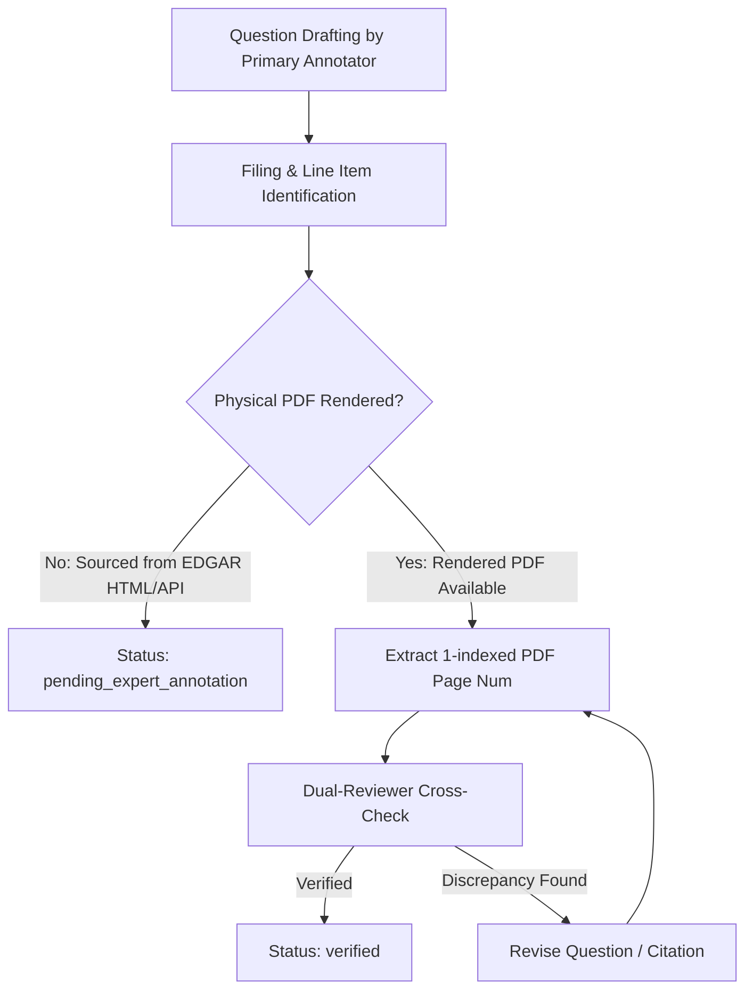

# FinSage Stage 3: Benchmark Annotation Guidelines

**Standard:** Publication-Grade Financial Question-Answering Evaluation  
**Target Output Path:** `outputs/experiments/experiment_stage3_heldout_validation/annotation_guidelines.md`  
**Governing Objective:** Provide rigorous, standardized procedures for annotating, verifying, and scoring independent financial evaluation benchmarks across SEC Form 10-K filings.

---

## 1. Objective and Guiding Principles

The Stage 3 validation dataset is designed to evaluate whether FinSage's retrieval architecture (specifically Experiment H2.1) successfully generalizes to unseen corporate entities and filing structures. To prevent annotation artifacts, ambiguity, or false negatives during evaluation, annotators must adhere to four core principles:

1. **Factual Determinate Answers:** Every question must have an unequivocal, factual answer contained entirely within the target SEC filing. Do not author subjective, speculative, or unanswerable queries.
2. **Explicit Ground Truth Provenance:** Every question must reference the exact document name, canonical fiscal period, 1-indexed physical PDF page number, and the exact textual or tabular quote.
3. **No Hallucinated Citations:** If physical PDF page numbers have not been verified against the rendered PDF document, the question must be tagged as `pending_expert_annotation` rather than falsely claimed as verified.
4. **Natural Query Phrasing:** Questions should mirror realistic user interactions from financial analysts, portfolio managers, and equity researchers, avoiding artificial keyword-stuffing.

---

## 2. Question Archetypes and Formulation Standards

Annotators must stratify questions across three distinct financial retrieval archetypes:

```
┌──────────────────────────────────────────────────────────────────────────────────┐
│                           QUESTION TAXONOMY STANDARDS                            │
├──────────────────────────────────────────────────────────────────────────────────┤
│                                                                                  │
│  Archetype A: Single-Statement Financial Queries (Target: 40% of benchmark)      │
│  - Targets primary consolidated financial statements (BS, IS, CF).               │
│  - Focuses on unambiguous line items for a specific fiscal year.                │
│  - Examples:                                                                     │
│    • "What was Apple's total net sales in fiscal year 2024?"                    │
│    • "What was NVIDIA's cash and cash equivalents balance as of January 2024?"  │
│    • "How much did ExxonMobil spend on capital expenditures in FY2023?"          │
│                                                                                  │
│  Archetype B: Multi-Statement & Financial Ratio Queries (Target: 20% of benchmark)│
│  - Requires retrieving figures from two separate statements or disclosure notes.  │
│  - Focuses on standardized financial ratios and year-over-year derivations.      │
│  - Standard Formulas Defined:                                                    │
│    • Operating Margin = Operating Income / Total Revenue                         │
│    • Return on Assets (ROA) = Net Income / Total Assets                         │
│    • Current Ratio = Total Current Assets / Total Current Liabilities            │
│    • Free Cash Flow = Operating Cash Flow - Capital Expenditures                │
│    • Debt-to-Equity = Total Debt (Short-Term + Long-Term) / Stockholders' Equity │
│                                                                                  │
│  Archetype C: Qualitative Narrative & MD&A Queries (Target: 40% of benchmark)    │
│  - Targets qualitative disclosures in Item 1 (Business), Item 1A (Risk Factors), │
│    or Item 7 (Management's Discussion and Analysis - MD&A).                      │
│    • Segment growth drivers and regional revenue headwinds.                      │
│    • Supply chain concentration risks and manufacturing dependencies.           │
│    • Legal contingencies, regulatory investigations, and environmental liabilities│
│                                                                                  │
└──────────────────────────────────────────────────────────────────────────────────┘
```

---

## 3. Evidence Extraction & Page Numbering Conventions

### 3.1 Canonical Page Numbering Definition
To maintain 100% compatibility with FinanceBench and the FinSage evaluation harness:
* **The canonical page number (`evidence_page_num`) MUST be the 1-indexed physical page number of the compiled PDF document.**
* Do **NOT** use the internal document printed page number (e.g. "Page 42" printed in the footer), because table of contents, cover sheets, and exhibit indexes introduce offsets (often 2–5 pages).
* Example: If the Consolidated Statements of Income has "Page 68" printed on the page footer, but in the PDF reader it corresponds to slide/page 72 of the PDF, the recorded `evidence_page_num` is **72**.

### 3.2 Snippet Quoting Rules
* **Tabular Line Items:** Quote the exact line-item label and the corresponding column value, including currency units and scaling factors (e.g. "$ in millions" or "in thousands").
* **Narrative Passages:** Quote the full sentence or bounding paragraph containing the answer. Avoid truncated phrases that strip essential context.

### 3.3 Answer Precision and Normalization
* **Monetary Values:** Always state the currency and magnitude explicitly (e.g., "$391,035 million" or "$391.04 billion").
* **Ratios and Percentages:** Round percentages to two decimal places (e.g., "14.28%").
* **Fiscal Periods:** Always specify the fiscal year or date to prevent ambiguity (e.g., "For the fiscal year ended September 28, 2024").

---

## 4. Verification Workflow & Status Tagging

Every question in the benchmark must proceed through a two-stage qualification process:



### Status Definitions:
1. `verified`:
   - Physical PDF page confirmed by independent human review.
   - Text snippet matched verbatim in document chunks.
   - Numerical answer reconciled against primary statement table.
2. `pending_expert_annotation`:
   - Filing identity, accession number, fiscal year, and target section confirmed.
   - Question formulated and preliminary financial concept identified.
   - Awaiting compiled PDF page-level confirmation and dual-signoff.

---

## 5. Negative Rules & Prohibited Practices

To protect benchmark integrity, the following practices are strictly prohibited:

- ❌ **No Post-Hoc Question Design:** Never write a question designed specifically to exploit or avoid known retrieval weaknesses in Experiment F or H2.1.
- ❌ **No External Knowledge:** Do not construct questions that require information from conference calls, press releases, or external financial databases unless explicitly stated in the 10-K.
- ❌ **No Page Number Guessing:** Never extrapolate or estimate page numbers based on neighboring filings. If unverified, mark as `pending_expert_annotation`.
- ❌ **No Leakage into Development Sets:** Never include any of the 32 development companies or 84 development filings in the held-out benchmark.
