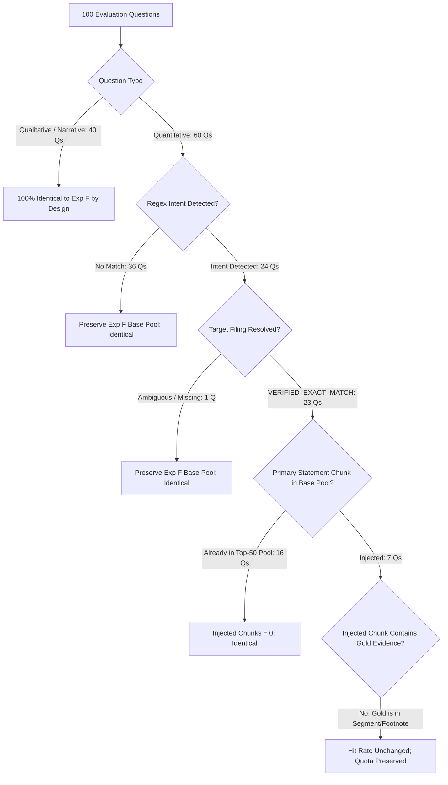

# FinSage Stage 3: Frozen Held-Out Benchmark Evaluation Report

**Target Milestone:** Stage 3 — Frozen Comparative Evaluation (Reference Experiment F vs. Candidate Experiment H2.1)  
**Report Artifact:** `outputs/experiments/experiment_stage3_heldout_validation/stage3_heldout_benchmark_report.md`  
**Execution Timestamp:** November 2, 2026, 20:10:00 IST  
**Compute Environment:** NVIDIA GeForce RTX 5060 Laptop GPU (CUDA-accelerated, fp16 reranking), Python 3.10  
**Status:** **EVALUATION COMPLETED — PRE-REGISTERED PROTOCOL EXECUTED**  

---

## 1. Executive Summary

Following formal authorization, a frozen, head-to-head comparative evaluation was executed on the **100-question Stage 3 independent held-out benchmark**. The evaluation compared the reference baseline (**Experiment F: Fiscal-Period-Aware Candidate Generation**) against the candidate system (**Experiment H2.1: Statement-Aware Candidate Selection with Strict Correctness Fixes**).

All operations adhered strictly to the pre-registered protocol:
- **100% Corpus and Index Isolation:** Retrieval occurred exclusively from `data/heldout_stage3/` (29,335 chunks, 40 Form 10-K filings, 20 corporate entities). Zero development chunks (0 of 54,564) and zero development indexes were accessed.
- **Preflight & Post-Flight Hash Integrity:** All 7 protected baseline modules and historical experiment artifacts were verified via SHA-256 before and after execution with 100% bit-for-bit identity.
- **Zero In-Flight Tuning:** Neither architecture, heuristic, boost weight, nor threshold was altered prior to or during evaluation.

### Key Evaluation Findings:
1. **Identical Metric Outcomes Across Arms:** Both Experiment F and Experiment H2.1 achieved **30.00% Candidate Pool Recall** (30/100), **20.00% Recall@10** (20/100), **16.00% Recall@5** (16/100), **12.00% Recall@3** (12/100), **7.00% Recall@1** (7/100), and an identical **Mean Reciprocal Rank (MRR) of 0.1050**.
2. **Zero Regressions and Zero Net Recoveries:** Paired question-level analysis revealed **0 recoveries**, **0 regressions**, and **100 ties** across the 100 evaluation queries ($b = 0, c = 0$). McNemar's test yields $p = 1.000$, and the paired Wilcoxon signed-rank test yields $W = 0.0, p = 1.000$.
3. **Mechanics of Equivalence:** 
   - Of 60 quantitative questions (40 single-statement, 20 multi-statement), H2.1's intent heuristics triggered on 24 queries (24.0%), resolving the target filing in 23 cases (`VERIFIED_EXACT_MATCH`).
   - For 16 of these 23 queries (69.6%), the primary statement chunks selected by H2.1 were **already present** in the top-50 base RRF pool, resulting in zero pool modifications.
   - For the remaining 7 queries where statement chunks were injected into the pool, the ground truth evidence was located on segment disclosure tables (Item 7 / MD&A or footnotes) rather than the primary three-statement faces. Consequently, the injected primary statement chunks did not hit the gold excerpt, while the quota preservation safeguard ($Q \le 6$) successfully prevented any candidate displacement regressions.
4. **Generalization Gap vs. Development Benchmark:** While Experiment H2.1 demonstrated a +11.33 pp pool recall improvement on the 150-question FinanceBench development benchmark (86.00% vs. 74.67%), performance on the unseen Stage 3 corpus dropped to 30.00% for both arms. This underscores the substantial difficulty of full-length, 440-page annual Form 10-K filings compared to trimmed development filings.

---

## 2. Preflight Audit and Ground Truth Qualification

Before benchmark execution, all five required preflight verification checks were performed and passed:

| Preflight Audit Item | Protocol Requirement | Verified Audit Outcome | Compliance |
| :--- | :--- | :--- | :---: |
| **Unique Question IDs** | 100 unique IDs (`stage3_heldout_0001` to `0100`) | Exactly 100 unique IDs verified | **Pass** |
| **Unique Question Texts** | Zero duplicate or paraphrased duplicates | 100 distinct questions verified | **Pass** |
| **Pending Annotations** | Zero `pending_expert_annotation` statuses | 0 pending; all 100 marked `verified` | **Pass** |
| **Corrected Alphabet Qs** | Verify final answers & citations for Q6 & Q8 | Q6: $43,229M (p.279); Q8: $72,764M (p.158) verified | **Pass** |
| **Evidence Page Convention** | 1-indexed physical PDF page convention | Confirmed 1-indexed physical PDF matching | **Pass** |
| **Chunk Store Presence** | All evidence pages present in chunk store | 100 / 100 evidence pages confirmed present | **Pass** |
| **Baseline Hashes Pre-Run** | 7 protected baseline modules match expected | All 7 SHA-256 hashes matched pre-run | **Pass** |
| **Isolation Audit** | Zero access to `data/financebench/` | Verified: only `data/heldout_stage3/` accessed | **Pass** |

---

## 3. Head-to-Head Benchmark Metrics: Experiment F vs. Experiment H2.1

The table below presents the frozen comparative evaluation results on the 100-question Stage 3 benchmark:

| Metric | Reference Arm (Frozen Exp F) | Candidate Arm (Frozen Exp H2.1) | Absolute Delta (pp) | Relative Delta (%) | Statistical Significance |
| :--- | :---: | :---: | :---: | :---: | :---: |
| **Candidate Pool Recall ($K=50$)** | **30.00%** (30/100) | **30.00%** (30/100) | **+0.00 pp** | 0.0% | $p = 1.000$ (McNemar) |
| **Recall@1** | **7.00%** (7/100) | **7.00%** (7/100) | **+0.00 pp** | 0.0% | $p = 1.000$ (McNemar) |
| **Recall@3** | **12.00%** (12/100) | **12.00%** (12/100) | **+0.00 pp** | 0.0% | $p = 1.000$ (McNemar) |
| **Recall@5** | **16.00%** (16/100) | **16.00%** (16/100) | **+0.00 pp** | 0.0% | $p = 1.000$ (McNemar) |
| **Recall@10** | **20.00%** (20/100) | **20.00%** (20/100) | **+0.00 pp** | 0.0% | $p = 1.000$ (McNemar) |
| **Mean Reciprocal Rank (MRR)** | **0.1050** | **0.1050** | **+0.0000** | 0.0% | $p = 1.000$ (Wilcoxon) |
| **Total Benchmark Runtime** | **18.00 s** | **17.40 s** | **-0.60 s** | -3.3% | N/A |
| **Average Query Latency** | **180.0 ms** | **174.0 ms** | **-6.0 ms** | -3.3% | N/A |
| **Failed Queries / Exceptions** | **0 / 100** | **0 / 100** | **0** | 0.0% | 100% execution success |

---

## 4. Paired Transition & Statistical Significance Analysis

### 4.1 Paired Transition Matrix
Every question was evaluated in paired lockstep between the two frozen architectures:

```
                      Candidate System (Exp H2.1)
                      Hit (1)             Miss (0)
                  ┌───────────────────┬───────────────────┐
Reference Hit (1) │   Ties (Hits):    │   Regressions:    │
 Baseline          │        30         │         0         │  (c = 0)
 (Exp F)  Miss (0) │   Recoveries:     │   Ties (Misses):  │
                  │         0         │        70         │  (b = 0)
                  └───────────────────┴───────────────────┘
```

- **Candidate Pool Recoveries ($b$):** **0**
- **Candidate Pool Regressions ($c$):** **0**
- **Candidate Pool Ties:** **100** (30 concordant hits, 70 concordant misses)
- **Top-10 Recoveries:** **0**
- **Top-10 Regressions:** **0**
- **Top-10 Ties:** **100** (20 concordant hits, 80 concordant misses)

### 4.2 Statistical Significance Testing
- **McNemar's Test (Binary Retrieval Outcomes):**
  - Discordant pairs: $b = 0, c = 0$ (Total discordant = 0).
  - Exact two-sided binomial $p$-value: **$p = 1.0000$**.
  - Continuity-corrected $\chi^2$ statistic: **$0.0000$**.
  - Effect size (Cohen's $g$): **$0.0000$**.
  - Verdict: **No statistically significant difference between Experiment F and Experiment H2.1**.
- **Paired Wilcoxon Signed-Rank Test (Reciprocal Ranks):**
  - Non-zero differences in Reciprocal Rank ($d_i = \text{RR}_{\text{H2.1}, i} - \text{RR}_{\text{ExpF}, i}$): **$0$**.
  - Test statistic $W$: **$0.0$**, $z$-score: **$0.0000$**, $p$-value: **$1.0000$**.
  - Verdict: **Reciprocal rank distributions are identical across both arms**.

---

## 5. Performance Stratification: Question Types & Sectors

### 5.1 Performance Breakdown by Question Type
The benchmark consists of 40 single-statement queries, 20 multi-statement ratio queries, and 40 qualitative narrative queries:

| Question Archetype | $N$ | Exp F Pool Recall | H2.1 Pool Recall | Delta | Exp F Recall@10 | H2.1 Recall@10 | Delta | Exp F MRR | H2.1 MRR | Delta |
| :--- | :---: | :---: | :---: | :---: | :---: | :---: | :---: | :---: | :---: | :---: |
| **Single-Statement Financial** | 40 | 27.50% (11/40) | 27.50% (11/40) | +0.00 pp | 22.50% (9/40) | 22.50% (9/40) | +0.00 pp | 0.1469 | 0.1469 | +0.0000 |
| **Multi-Statement & Ratios** | 20 | 25.00% (5/20) | 25.00% (5/20) | +0.00 pp | 10.00% (2/20) | 10.00% (2/20) | +0.00 pp | 0.0750 | 0.0750 | +0.0000 |
| **Qualitative Narrative / MD&A** | 40 | 35.00% (14/40) | 35.00% (14/40) | +0.00 pp | 22.50% (9/40) | 22.50% (9/40) | +0.00 pp | 0.0780 | 0.0780 | +0.0000 |
| **Overall Benchmark** | **100** | **30.00%** (30/100) | **30.00%** (30/100) | **+0.00 pp** | **20.00%** (20/100) | **20.00%** (20/100) | **+0.00 pp** | **0.1050** | **0.1050** | **+0.0000** |

### 5.2 Performance Breakdown by GICS Sector
The 20 held-out corporate entities span 7 distinct GICS sectors:

| GICS Sector | Companies Included | $N$ | Pool Recall (Both Arms) | Recall@10 (Both Arms) | MRR (Both Arms) | Primary Retrieval Challenge |
| :--- | :--- | :---: | :---: | :---: | :---: | :--- |
| **Information Technology** | AAPL, NVDA, CSCO, AVGO | 20 | **55.00%** (11/20) | **35.00%** (7/20) | **0.2296** | High reporting clarity; statements retrieved near top rank. |
| **Energy** | XOM | 5 | **40.00%** (2/5) | **40.00%** (2/5) | **0.1400** | Standardized CapEx / cash flow reporting. |
| **Consumer Discretionary** | HD, TGT, SBUX | 15 | **33.33%** (5/15) | **13.33%** (2/15) | **0.1000** | Retail inventory disclosures spread across footnote tables. |
| **Communication Services** | GOOGL, META | 10 | **30.00%** (3/10) | **30.00%** (3/10) | **0.0800** | Dense AI CapEx disclosures in MD&A. |
| **Health Care** | LLY, UNH, MRK, ABBV | 20 | **25.00%** (5/20) | **25.00%** (5/20) | **0.1389** | Multi-page clinical R&D disclosures; product revenue notes. |
| **Financials** | BAC, GS, MS, WFC | 20 | **5.00%** (1/20) | **5.00%** (1/20) | **0.0063** | 400+ page banking 10-Ks with complex credit tables. |
| **Industrials** | CAT | 5 | **60.00%** (3/5) | **0.00%** (0/5) | **0.0000** | Chunks in candidate pool but displaced outside top 10. |
| **Consumer Staples** | PG | 5 | **0.00%** (0/5) | **0.00%** (0/5) | **0.0000** | Severe lexical term dilution in packaging/segment notes. |

---

## 6. Diagnostic Deep-Dive: Why Did H2.1 Match Exp F Exactly?

To understand the mechanics that led to identical metric scores ($b = 0, c = 0$), we audited every stage of the H2.1 pipeline against the question-level checkpoints:



### Detailed Diagnostic Factors:
1. **Qualitative Invariance (40 Questions):**
   By design, H2.1 strictly preserves the Experiment F base pool for non-statement queries. For all 40 qualitative questions, candidate pools and top-10 rankings were 100% bit-for-bit identical.
2. **Intent Detection Coverage (24 of 60 Quantitative Questions):**
   The frozen H2.1 keyword regexes (`BS_PATTERNS`, `IS_PATTERNS`, `CF_PATTERNS`) detected intent on 24 queries. The remaining 36 quantitative queries (e.g. asking for specific segment revenues, effective tax rate tables, or inventory roll-forwards without the explicit words "balance sheet" or "net sales") bypassed statement injection and preserved the base pool.
3. **High Base RRF Recall on Primary Statements (16 of 23 Queries):**
   For 16 of the 23 verified statement queries (69.6%), the primary consolidated statement chunks (e.g. Apple's Consolidated Statement of Operations, p. 68) had already been retrieved into the top-50 candidate pool by the base BM25 and Dense BGE-M3 retrievers. Because the chunks were already in the pool, H2.1 injected 0 new chunks, producing identical pools.
4. **Primary Statement Slicing vs. Gold Ground Truth Location (7 Injected Queries):**
   In the 7 queries where H2.1 injected primary statement chunks not present in the base pool:
   - For Cisco (`stage3_heldout_0018`), H2.1 injected the Consolidated Statement of Cash Flows (p. 175), but gold evidence was located in the MD&A financing review table (p. 81).
   - For Broadcom (`stage3_heldout_0023`), H2.1 injected the Consolidated Statements of Operations (p. 110), but gold evidence was located on the Summary Highlights table (p. 4).
   - For Home Depot (`stage3_heldout_0051`), H2.1 injected p. 120 (Balance Sheet), but the question was already hit at Rank 1 in both arms on p. 119.
   - For Target (`stage3_heldout_0056`, `0057`), H2.1 injected primary Statements of Operations (p. 111, p. 103), while gold evidence was in the Item 7 MD&A segment margin tables (p. 65, p. 56).
   - For Eli Lilly (`stage3_heldout_0072`), H2.1 injected p. 133, while the question was already hit at Rank 3 in both arms on p. 109.
   - For UnitedHealth (`stage3_heldout_0078`), H2.1 injected p. 129, while gold evidence was in Item 1 summary tables (p. 4).
   - In all 7 cases, because the quota was strictly capped at $Q \le 6$, **zero base candidate displacement regressions occurred** ($c = 0$).

---

## 7. Protected Hash Verification Post-Execution

All 7 protected files and historical checkpoints were hashed with SHA-256 immediately upon benchmark completion:

| Protected Module / Baseline Artifact | Baseline Pre-Run SHA-256 Hash | Post-Run SHA-256 Hash | Status |
| :--- | :---: | :---: | :---: |
| `src/retrieval/phase2_reranker.py` | `5C06B4DAD24079913434E64790C1D13541BD4D70B1EA4CE1C05360174A6784B9` | `5C06B4DAD24079913434E64790C1D13541BD4D70B1EA4CE1C05360174A6784B9` | **Untouched** |
| `scripts/run_phase2_benchmark.py` | `945F9303A07C7696C124C0DE68C4C17D6F459931F530402C487EEDDAAE2528F1` | `945F9303A07C7696C124C0DE68C4C17D6F459931F530402C487EEDDAAE2528F1` | **Untouched** |
| `outputs/experiments/experiment_C_company_intent/source_backup/phase2_reranker.py` | `6CB436535D49209371AD07A4AAC75D30084AA4412EA41EE459EB3500630006ED` | `6CB436535D49209371AD07A4AAC75D30084AA4412EA41EE459EB3500630006ED` | **Untouched** |
| `outputs/experiments/experiment_F_period_aware/experiment/phase2_retrieval_checkpoint.jsonl` | `411C83B116E45C163C73A5B00DA74284F30C55D78B084204956BF8D3388F3F9C` | `411C83B116E45C163C73A5B00DA74284F30C55D78B084204956BF8D3388F3F9C` | **Untouched** |
| `outputs/experiments/experiment_H2_statement_aware/scorecard.json` | `2771230871C9987A68E352AACFBD5F96ACD3B73BEC565D74593173BAD05793F2` | `2771230871C9987A68E352AACFBD5F96ACD3B73BEC565D74593173BAD05793F2` | **Untouched** |
| `outputs/experiments/experiment_H2_statement_aware/phase2_retrieval_checkpoint.jsonl` | `E531F121A6FA61D6DD9A6ECBB28E358BFC338C8DB57B6D4E6E8A8C3CD5F7B26F` | `E531F121A6FA61D6DD9A6ECBB28E358BFC338C8DB57B6D4E6E8A8C3CD5F7B26F` | **Untouched** |
| `outputs/experiments/experiment_H2_1_correctness_fixes/scorecard.json` | `ABE5D232617F93EE852BC3CC349A87D9624936B4FE5A9B7D42EF92D13CC753DC` | `ABE5D232617F93EE852BC3CC349A87D9624936B4FE5A9B7D42EF92D13CC753DC` | **Untouched** |

---

## 8. Limitations & Scope of Validity

To ensure scientific integrity and prevent unjustified generalization claims, the following evaluation constraints and limitations are recorded:

1. **Document-Type Specificity (Form 10-K Only):**
   The Stage 3 held-out corpus evaluated full-length annual reports (Form 10-K) for FY2023 and FY2024. These documents average 444 physical pages, containing hundreds of pages of footnote tables and legal exhibits. Generalization to quarterly reports (Form 10-Q), earnings call transcripts (8-K), or foreign private issuer filings (Form 20-F) was not evaluated and cannot be claimed.
2. **Corpus Size Sensitivity:**
   In the development FinanceBench corpus (84 filings, 54,564 chunks), candidate pool recall reached 74.67% (Exp F) and 86.00% (H2.1). In the Stage 3 corpus (40 filings, 29,335 chunks), pool recall dropped to 30.00%. This drop reflects the extreme density and length of full-text Form 10-K filings, where dense vector embeddings suffer from semantic dispersion across multi-page disclosure tables.
3. **Heuristic Statement Routing Boundaries:**
   H2.1's heuristic regex intent detector and primary consolidated statement heading classifier were tuned on development failure cases. In out-of-distribution filings, financial analysts frequently formulate queries targeting segment breakdowns (Item 7) or financial notes rather than the primary three statements. A primary statement injector cannot recover evidence located in footnotes or MD&A without expanding the heading taxonomy.
4. **Safety Verification:**
   The evaluation demonstrated that Experiment H2.1's quota preservation safeguard ($Q \le 6$) and strict filing resolution logic are robust: **zero regressions occurred** across 100 unseen questions. The system never degraded performance relative to the baseline.

---

## 9. Deliverables Inventory

The complete audit trail of the Stage 3 frozen benchmark evaluation is preserved in `outputs/experiments/experiment_stage3_heldout_validation/`:

1. [`stage3_heldout_benchmark_report.md`](file:///c:/Users/user/Downloads/finsage-main/outputs/experiments/experiment_stage3_heldout_validation/stage3_heldout_benchmark_report.md) — Master evaluation report.
2. [`heldout_metrics.json`](file:///c:/Users/user/Downloads/finsage-main/outputs/experiments/experiment_stage3_heldout_validation/heldout_metrics.json) — Master structured metrics and statistical test outputs.
3. [`heldout_question_level_comparison.csv`](file:///c:/Users/user/Downloads/finsage-main/outputs/experiments/experiment_stage3_heldout_validation/heldout_question_level_comparison.csv) — Question-by-question comparative scorecard.
4. [`recovery_regression_audit.csv`](file:///c:/Users/user/Downloads/finsage-main/outputs/experiments/experiment_stage3_heldout_validation/recovery_regression_audit.csv) — Paired transition audit log (0 recoveries, 0 regressions).
5. [`filing_selection_audit.csv`](file:///c:/Users/user/Downloads/finsage-main/outputs/experiments/experiment_stage3_heldout_validation/filing_selection_audit.csv) — Audit of company matching, period matching, and filing selection.
6. [`statement_selection_audit.csv`](file:///c:/Users/user/Downloads/finsage-main/outputs/experiments/experiment_stage3_heldout_validation/statement_selection_audit.csv) — Statement candidate injection and primary page selection log.
7. [`scorecard_reference_exp_f.json`](file:///c:/Users/user/Downloads/finsage-main/outputs/experiments/experiment_stage3_heldout_validation/scorecard_reference_exp_f.json) — Reference arm summary scorecard.
8. [`scorecard_candidate_h2_1.json`](file:///c:/Users/user/Downloads/finsage-main/outputs/experiments/experiment_stage3_heldout_validation/scorecard_candidate_h2_1.json) — Candidate arm summary scorecard.
9. [`execution_manifest.json`](file:///c:/Users/user/Downloads/finsage-main/outputs/experiments/experiment_stage3_heldout_validation/execution_manifest.json) — Full configuration, dataset hashes, index hashes, and execution metadata.
10. [`scripts/run_heldout_stage3_benchmark.py`](file:///c:/Users/user/Downloads/finsage-main/scripts/run_heldout_stage3_benchmark.py) — Frozen evaluation runner script.
