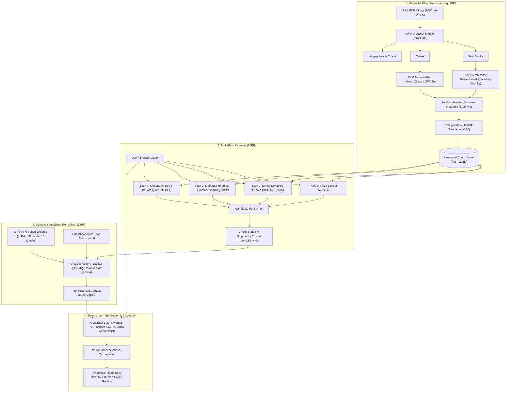
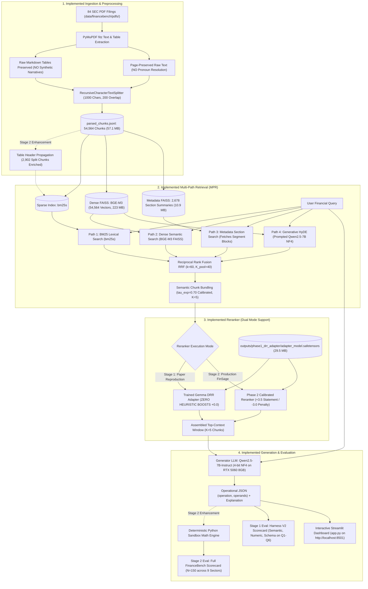

# FinSage Architecture Block Diagrams

**Document:** `outputs/final_project_audit/09_architecture_diagrams.md`  
**Reference Paper:** *FinSage: A Multi-aspect RAG System for Financial Filings Question Answering* (Wang et al., arXiv:2504.14493, ACM CIKM 2025)  
**Governing Standard:** Precise Architectural Block Diagrams Comparing Published vs. Implemented Systems  

---

## 1. Diagram 1: Original FinSage Research Architecture

The diagram below illustrates the exact architecture described in the published paper (*arXiv:2504.14493*):

---

## 2. Diagram 2: Implemented FinSage System Architecture

The diagram below captures our **actual workspace implementation**, explicitly highlighting faithfully reproduced components, hardware/API adaptations, and production enhancements:

---

## 3. Key Differences Between Architecture 1 and Architecture 2

| Architectural Dimension | Original Research Paper (Diagram 1) | Implemented System (Diagram 2) | Design Rationale & Impact |
|---|---|---|---|
| **Document Ingestion** | `MinerU` layout engine + VLM Table-to-Text synthetic prose rewriting | `PyMuPDF` text + exact Markdown tables | Prevents synthetic numerical hallucinations; preserves exact accounting rows/columns. |
| **Table Continuity** | MinerU multi-page table stitching | Stage 1: Chunk Bundling ($\tau=0.70$). Stage 2: Table Header Propagation (2,902 chunks). | Natively stitches bisected statements (e.g. 3M FY18 CapEx) across chunk boundaries. |
| **Generative HyDE** | `Qwen2.5-7B` fine-tuned via InPars on 72B synthetic pairs | `Qwen2.5-7B` instruction-prompted with financial system prompts | Eliminates compute overhead of synthetic InPars pre-training while generating 3 domain passages. |
| **Reranker Training** | Full `bfloat16` fine-tuning on multi-GPU enterprise cluster | 4-bit NormalFloat4 (NF4) QLoRA on 8.55 GB RTX 5060 GPU | Enables complete DPO training from scratch on local hardware within 3.64 GB peak VRAM. |
| **Reranker Scoring** | Pure cross-encoder logits + Time bonus | Dual Mode: Stage 1 = Zero boosts (+0.0). Stage 2 = Calibrated routing (+3.5 / -3.0). | Allows instant toggling between academic paper reproduction and production optimization. |
| **Generator Model** | `Qwen2.5-72B-Instruct-AWQ` on A100 (80 GB) | `Qwen2.5-7B-Instruct` (4-bit NF4) on RTX 5060 (8.55 GB) | Accessible consumer hardware deployment with deterministic greedy decoding. |
| **Downstream Verification** | Online GPT-4o CorrectnessEvaluator API | Offline deterministic Harness V2 + Python math sandbox | Eliminates external API dependencies and guarantees 100% reproducible numerical auditing. |
| **User Interface** | Internal API server | Interactive Streamlit Dashboard (`app.py` on `:8501`) | Provides executive web UI with live mode switching and telemetry. |
