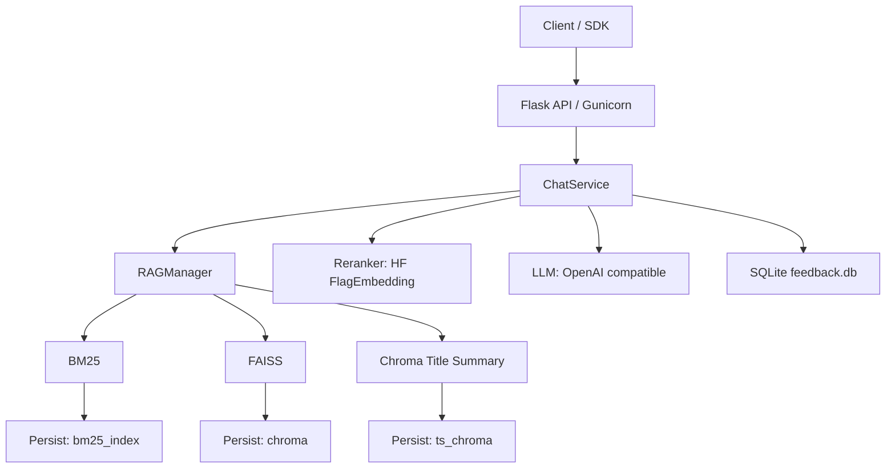

# RAG Agent Production

<p align="center">
  
</p>

<p align="center">
  
  
  
  
  
</p>

一个面向生产的 RAG Agent 服务，支持多检索器集成（BM25/FAISS/标题摘要）、可插拔重排器（Hugging Face/FlagEmbedding），并提供 REST API 与日志/反馈管理。

## News

2025/04/20 → 2025/08/13 🔥 We released and iterated the FinSage paper on arXiv (arXiv:2504.14493), from v1 (2025/04/20) to v4 (2025/08/13).

2025/08/11 🎉 Our paper was accepted to ACM CIKM 2025 (Applied Research Track) (notification date).

<!-- START doctoc generated TOC please keep comment here to allow auto update -->
<!-- DON'T EDIT THIS SECTION, INSTEAD RE-RUN doctoc TO UPDATE -->
## Contents

* [Usage](#usage)
* [配置](#配置)
* [API](#api)
* [生产环境部署](#生产环境部署)
  * [开启API服务器](#开启api服务器)
  * [关闭服务](#关闭服务)
  * [查看日志](#查看日志)
  * [模块测试](#模块测试)
* [Results](#results)
* [Citation](#citation)
<!-- END doctoc generated TOC please keep comment here to allow auto update -->

---

## Performance on the company dataset.
“Avg Num Retrieved" represents the average number of chunks in the retrieved set. Recall, Precision, and F1 scores are calculated based on the relevant chunks retrieved. The bold denotes the best Recall, Precision and F1 produced from FinSage.

| Category            | Method                           | Avg Recall | Avg Precision | Avg F1     | Avg Num Retrieved |
| ------------------- | -------------------------------- | ---------- | ------------- | ---------- | ----------------- |
| **FAISS Retrieval** | FAISS (Baseline)                 | 0.8194     | 0.0941        | 0.1646     | 75.6              |
|                     | + Bundle Expansion (Exp)         | 0.8103     | 0.0999        | 0.1733     | 70.25             |
| **BM25 Retrieval**  | + BM25                           | 0.8452     | 0.1147        | 0.1949     | 66.24             |
|                     | + Metadata                       | 0.8573     | 0.1198        | 0.2037     | 64.87             |
| **HyDE Retrieval**  | HyDE-1: HyDE(Qwen7B)             | 0.8228     | 0.1076        | 0.1830     | 69.09             |
|                     | HyDE-2: HyDE(Qwen7B-SFT)         | 0.8567     | 0.1072        | 0.1831     | 72.92             |
|                     | HyDE-3: HyDE(Qwen72B)            | 0.8323     | 0.1078        | 0.1844     | 69.77             |
| **FinSage**         | + BM25 + Metadata + HyDE-2 + Exp | **0.9251** | **0.1272**    | **0.2156** | 68.75             |

---


## 架构图



## Usage

- 快速开始
  1. 准备配置：复制 `config/example.yaml` 为 `config/production.yaml`，或设置环境变量 `CONFIG_PATH` 指向你的配置文件。
  2. 启动外部LLM服务：确保有一个兼容 OpenAI API 的推理服务（如 vLLM），并在配置中设置 `llm_base_url` 和 `llm_model_name`。
  3. 启动API服务：

```bash
cd src
gunicorn -w 1 -b 0.0.0.0:6005 --timeout 180 server:app
```

  4. 调用接口：见下方 API 小节。

- Reranker 权重
  - 将你的重排模型发布到 Hugging Face，并在配置中将 `rerank_model` 设置为仓库ID（或本地路径）。例如：`BAAI/bge-reranker-v2-gemma`。
  - 通过 `rerank_topk` 控制最终参与答案生成的 chunk 数量。

## 配置

服务默认从环境变量 `CONFIG_PATH` 指向的文件加载配置；若未设置，则在 `src/server.py` 中默认读取 `../config/production.yaml`。

<details>
<summary>示例（关键字段）</summary>


```yaml
persist_directory: "/path/to/database_root"

embeddings_model_name: "BAAI/bge-m3"

llm_model_name: "Qwen/Qwen2.5-72B-Instruct-AWQ"
llm_base_url: "http://127.0.0.1:8000/v1"  # 需要外部OpenAI兼容推理服务
llm_api_key: "EMPTY"

rerank_model: "BAAI/bge-reranker-v2-gemma"  # 可填写你的HF仓库ID
rerank_topk: 5

frequent_qa_directory: "/path/to/frequentQA.db"         # 可选
qa_table_directory: "/path/to/qa_table.db"               # 可选
qa_table_persist_directory: "/path/to/qa_chroma_dir"     # 可选

log_level: "INFO"  # DEBUG/INFO/WARNING/ERROR/CRITICAL
bearer_token: "<your_token>"  # 或通过环境变量 BEARER_TOKEN 提供
```

</details>

注意：
- `persist_directory` 下应包含已构建的检索索引：`chroma/`、`ts_chroma/` 和 `bm25_index/<collection_name>/`。
- 代码当前默认注册集合为 `{'lotus': 10}`（见 `src/server.py`）；如需变更集合或 topk，请在代码中修改或扩展为配置项。

## API

- 健康检查

```bash
curl http://127.0.0.1:6005/health
```

- Token校验

```bash
curl -H "Authorization: Bearer <your_token>" http://127.0.0.1:6005/api/check_token | cat
```

- 同步问答

```bash
curl -X POST http://127.0.0.1:6005/api_chat \
  -H "Authorization: Bearer <your_token>" \
  -H "Content-Type: application/json" \
  -d '{"question":"你好","session_id":"test-session"}' | cat
```

- 流式问答（SSE）

```bash
curl -N -X POST http://127.0.0.1:6005/api_chat_stream \
  -H "Authorization: Bearer <your_token>" \
  -H "Content-Type: application/json" \
  -d '{"question":"你好","session_id":"test-session"}'
```

## 生产环境部署

### 开启API服务器

1. 进入或创建screen会话（可选） `screen -S gunicorn` / `screen -r gunicorn`
2. 启动服务（从项目根执行）：`cd src && gunicorn -w 1 -b 0.0.0.0:6005 --timeout 180 server:app`
3. 使用 `Ctrl-a` 和 `d` 从会话中分离

### 关闭服务

#### 1. 关闭app
1. `lsof -i :6005` 找到app的PID
2. `kill [pid]`

#### 2. 关闭vllm
1. `ps aux | grep vllm` 找到和启动vllm对应的进程
2. `kill -2 [pid]` 发送SIGINT，完成cleanup

### 查看日志

#### 1. app日志
1. `src/server.log`
2. 备份目录（收到退出信号或进程结束时会尝试拷贝）：`/root/autodl-tmp/server_logs`

#### 2. 外部LLM服务日志

请参考你部署的 OpenAI 兼容服务（如 vLLM）自身的日志路径与说明。

#### 3. 用户反馈日志

* `log/error`: 用户反馈问题和session log
* `log/feedback.db`: 用户反馈评分和session log

### 模块测试

#### Ensemble Retriever测试
```bash
cd src
python -m utils.ensembleRetriever
```

## Results

### 5.1 多路径检索（MPR）结果

FinSage 通过多路径稀疏-稠密检索架构显著优于单路径方案。相较单一路径的 FAISS 或 BM25，多路径（FAISS/BM25/标题摘要检索等）在相同候选规模下取得更高的召回与更稳定的精度，体现出 Mix-of-Retrievers 的优势。

### 5.2 文档重排序（DRR）结果

与通用重排器（bge-reranker-v2-Gemma）相比，经过任务自适应训练的专用重排器在 Top-5/Top-10 配置下均显著更优，召回约提升 ~15%，且能有效过滤无关片段，Precision 明显上升。同时，随着输出 chunk 数增加，Precision/MRR/nDCG 呈下降趋势，印证“5～10 个 chunk 通常足够”的经验。

R=5（每个检索器5条候选）：

| 设定                  | Precision | Normalized Recall | MRR    | Binary nDCG |
|-----------------------|-----------|-------------------|--------|-------------|
| Top-5 BGE             | 0.5913    | 0.6043            | 0.6570 | 0.7540      |
| Top-5 训练重排器      | 0.7324    | 0.7456            | 0.7078 | 0.8124      |
| Top-10 BGE            | 0.3771    | 0.6881            | 0.3854 | 0.6011      |
| Top-10 训练重排器     | 0.4424    | 0.7783            | 0.3338 | 0.6097      |

R=10（每个检索器10条候选）：

| 设定                  | Precision | Normalized Recall | MRR    | Binary nDCG |
|-----------------------|-----------|-------------------|--------|-------------|
| Top-5 BGE             | 0.6028    | 0.6130            | 0.6540 | 0.7638      |
| Top-5 训练重排器      | 0.7878    | 0.7910            | 0.7545 | 0.8533      |
| Top-10 BGE            | 0.4133    | 0.5985            | 0.4533 | 0.6285      |
| Top-10 训练重排器     | 0.5657    | 0.8196            | 0.5155 | 0.6958      |

### 5.3 端到端问答结果（LLM/人工）

带“∗”为我们的实验；其他来自原论文。

| 数据集       | 方法                           | LLM   | 人工   |
|--------------|--------------------------------|-------|--------|
| FinanceBench | Islam et al.                   |  -    | 0.1900 |
| FinanceBench | Jimeno-Yepes et al.            | 0.3262| 0.3688 |
| FinanceBench | Setty et al.                   | 0.2560|   -    |
| FinanceBench | FinSage∗                       | 0.4966| 0.5705 |
| Company      | FinSage∗                       | 0.8533| 0.8800 |

### 5.4 与图谱RAG方案的比较

响应时延（秒）：

| 方法      | Mean  | Median | Min  | Max    |
|-----------|-------|--------|------|--------|
| GraphRAG  | 16.90 | 15.27  | 9.86 | 40.67  |
| LightRAG  | 12.16 | 8.84   | 3.41 | 859.51 |
| FinSage   | 19.34 | 18.57  | 8.57 | 40.02  |

Faithful 评分：

| 方法      | 问题数            | Mean | Median | Min | Max | Pass %  |
|-----------|-------------------|------|--------|-----|-----|---------|
| GraphRAG  | 71（含4次失败）    | 3.46 | 3.50   | 2.0 | 5.0 | 42.50%  |
| LightRAG  | 75                | 2.45 | 2.00   | 1.0 | 5.0 | 13.67%  |
| FinSage   | 75                | 4.31 | 5.00   | 1.0 | 5.0 | 82.67%  |

### 5.5 系统效率与成本估计

| 步骤 | 流程                      | 时间(s) | 模型       | Token 估计             | 成本估计                 |
|------|---------------------------|---------|------------|------------------------|--------------------------|
| 1    | Query 重写                | ~2.5    | GPT-4o     | ~1200                  | ~$0.005                  |
| 2    | HyDE（每子问题，异步）    | ~4.2    | GPT-4o     | ~500                   | ~$0.002 × n             |
| 3    | 检索与重排                | ~4.7    | 本地       | N/A                    | 24GB GPU                 |
| 4    | 子问题回答（异步）        | ~4.7    | GPT-4o     | ~2500                  | ~$0.012 × n             |
| 5    | 最终答案合并              | ~1.7    | GPT-4o     | ~200 + 200 × n         | ~$0.002 + $0.002 × n     |
| —    | 总计                      | ~13–17  | —          | ~3.7k + 3k × n         | ~$0.017 + $0.016 × n     |

注：n 为子问题数。

### 5.6 检索延迟

| 方法              | Avg Time (s) |
|-------------------|--------------|
| FAISS             | 0.057        |
| Metadata(FAISS)   | 0.050        |
| BM25              | 0.014        |
| Total             | 0.121        |

### 5.7 问题类别分布与平均得分

| 类别                          | 数量 | 占比   | 平均分 |
|-------------------------------|------|--------|--------|
| business_products_competition | 952  | 38.4%  | 4.23/5 |
| basic_info_equity_structure   | 765  | 30.8%  | 4.22/5 |
| financial_status_Performance  | 697  | 28.1%  | 3.88/5 |
| regulatory_policy             | 68   | 2.7%   | 4.40/5 |

## Related Projects

* [RAG-based Financial Question Answering](https://github.com/OpenGVLab/RAG-FinancialQA)
* [MLC LLM](https://github.com/mlc-ai/mlc-llm)

## Citation

If you use **FinSage** in your research, please cite the paper:

```
@article{FinSage,
  title={FinSage: A Multi-aspect RAG System for Financial Filings Question Answering},
  author={Wang, Xinyu and Chi, Jijun and Tai, Zhenghan and Kwok, Tung Sum Thomas and Li, Muzhi and others},
  journal={arXiv preprint arXiv:2504.14493},
  year={2025}
}
```
